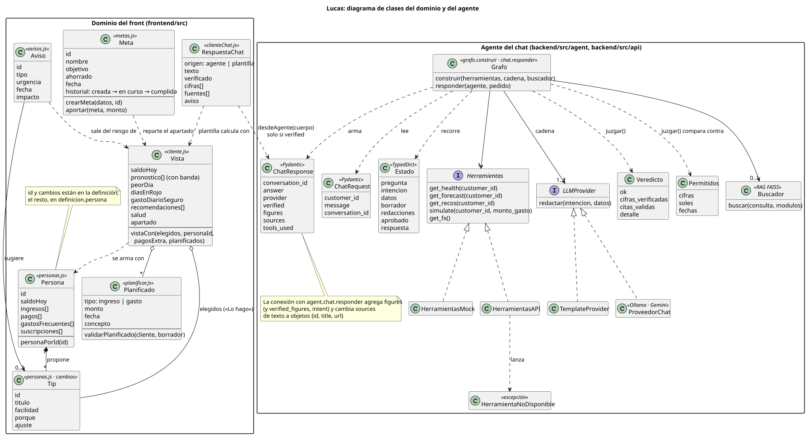
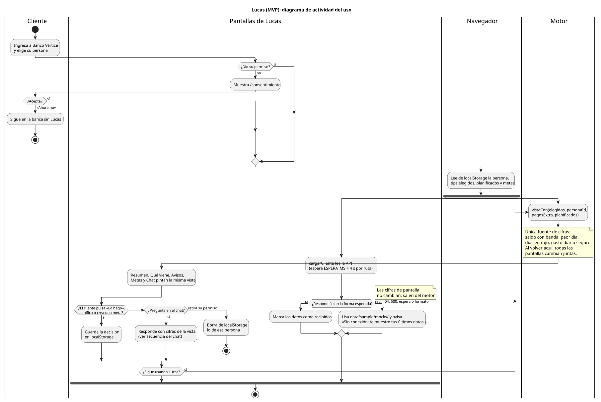
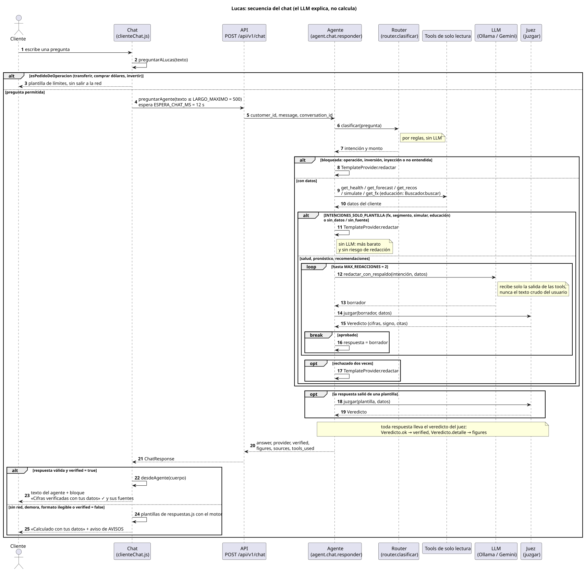

# Arquitectura de Lucas (MVP)

Responsable: Michael (arquitectura de sistema y seguridad). Describe lo que corre en `develop`. Lo que hace cada pantalla está en [docs/casos-uso.md](docs/casos-uso.md) y en las [historias](.claude/planes/historias.md).

## 1. Intención

Lucas responde una pregunta: «¿cuánto puedo gastar o ahorrar este mes sin quedarme en rojo antes de mi próximo ingreso, y qué cambio me conviene más?». La arquitectura del MVP existe para que:

1. **Cada cifra de cliente salga de un solo camino de cálculo.** Banca, Resumen, Qué viene, avisos, metas y chat llaman al mismo motor (`app/src/motor/`). Si dieran números distintos, la demo se contradiría.
2. **La demo funcione sin internet ni servidor.** El motor corre en el navegador; si la API no responde, Lucas lo dice y sigue con las mismas cifras.
3. **Toda cifra de evidencia salga de una medición.** El panel Evidencia lee los `models/metricas*.json` que generan los scripts de `eval/`; ninguna cifra se escribe a mano.

### Objetivos y no objetivos del MVP

| Objetivos | No objetivos |
|---|---|
| Un front que se vea y se use como una banca real, con Lucas dentro | Autenticación real de usuarios (la pone el banco que integre a Lucas) |
| Un motor de cálculo único en el front, con pruebas | Base de datos en línea: lo que la persona elige vive en su navegador |
| Analítica e IA medidas contra su baseline, con sus cifras en el panel Evidencia | Mover dinero, ejecutar operaciones o recomendar productos concretos |

## 2. Componentes

```
┌──────────────────────────── NAVEGADOR (app/, React + Vite) ────────────────────────────┐
│  Banco Vértice: /ingresar → /consentimiento → /banca → /lucas/:seccion   ·  /evidencia  │
│                                    │                                         │          │
│                       app/src/motor/ (motor de cálculo)        models/metricas*.json    │
│                       personas.js · motor.js · cliente.js      (importados en la build) │
│                                    │                                                    │
│                       localStorage: persona, permiso, tips, planificados, metas, avisos │
│                                    │                                                    │
│                       app/src/api/ (lee y valida; respaldo en data/sample/mocks/)       │
└────────────────────────────────────┼───────────────────────────────────────────────────┘
                                     │ HTTP /api/v1 (Vite lo pasa al puerto 8000)
┌────────────────────────────────────┼─────────────── PYTHON ────────────────────────────┐
│  src/api/  FastAPI: 12 rutas con datos fijos de `demo-001`                              │
│                                                                                         │
│  Por separado, sin conexión a la API en el MVP:                                          │
│  src/agent/            agente del chat (LangGraph: router → tools → redacción → juez)    │
│  src/agente_analitico/ agente de la evaluación (memoria, vigilancia, traducción)         │
│  src/generador/ → data/ → src/models/ → eval/ → models/*.pkl y models/metricas*.json     │
│  src/rag/ (índice FAISS en docs/rag/indice/)   ·   src/bcrp/ (tipo de cambio con caché)  │
└─────────────────────────────────────────────────────────────────────────────────────────┘
```

### 2.1 Front (`app/`)

React 19 con Vite, Recharts para los gráficos, Phosphor para los íconos y Manrope instalada como paquete, así no depende de internet.

| Carpeta | Qué hace |
|---|---|
| `src/banca/` | Ingreso de Banco Vértice, consentimiento, inicio de la banca y Preferencias. Elegir la persona es el inicio de sesión de la demo |
| `src/lucas/` | Las pantallas de Lucas: Resumen, Gastos, Qué viene (con el simulador), Chat, Avisos, Metas, Salud y Lo que aprendí de ti. También las reglas de avisos, metas, planificación y las respuestas del chat |
| `src/motor/` | El motor de cálculo y las dos personas sintéticas |
| `src/api/` | Única puerta a la API: pedidos con espera de 4 s, validación de cada respuesta y respaldo a `data/sample/mocks/` |
| `src/evidencia/` | Panel para el jurado, armado con los `models/metricas*.json` |
| `src/componentes/`, `src/estilos/` | Piezas comunes, tokens de diseño y temas claro y oscuro |

### 2.2 Motor de cálculo (`app/src/motor/`)

Es el único que produce cifras de cliente. Es un sustituto simple del pronóstico y del recomendador de `src/models/`, hecho para que las pantallas nunca se contradigan mientras la API no devuelva datos de la misma persona.

- `personas.js`: las dos personas sintéticas, independiente y formal, con sus cobros, pagos programados, gastos frecuentes, suscripciones, categorías, movimientos y tips. El arquetipo solo sirve para elegir a quién mostrar; nunca entra al cálculo.
- `motor.js`: funciones puras. Saldo diario con banda (se abre con los días y se ensancha en cada cobro variable), peor día antes del cobro, días en rojo, gasto diario seguro, efecto de cada tip, apartado sin rojo y cuánto cabe en una fecha.
- `cliente.js`: `vistaCon(elegidos, persona, pagosExtra, planificados)` arma la vista completa de la persona con sus tips, sus gastos planificados y la salud. **Todo lo que cambia con «Lo hago», con lo planificado o con la persona pasa por aquí.**

Reglas que vigilan las pruebas (`app/pruebas/motor.test.js`, `personas.test.js`):

1. Ninguna pantalla calcula una cifra por su cuenta: todas leen la vista de `vistaCon`.
2. Las dos personas usan las mismas fórmulas; solo cambian sus datos.
3. Cada tip se mide sobre los otros ya elegidos, así sus efectos se pueden sumar.

### 2.3 API (`src/api/`)

FastAPI con esquemas Pydantic. Expone 12 rutas bajo `/api/v1` más `/api/v1/health`, según el contrato de [docs/api.md](docs/api.md):

| Método | Ruta | Qué devuelve hoy |
|---|---|---|
| GET | `/customers/{customer_id}/health`, `/forecast`, `/recommendations`, `/events`, `/goals`, `/offers` | Datos fijos de `demo-001` |
| POST | `/customers/{customer_id}/goals`, `/expenses` | Validan y responden 201, sin guardar |
| POST | `/simulations` | Diferencia de saldo de cambios hipotéticos |
| GET | `/fx` | Tipo de cambio de respaldo, marcado como desactualizado |
| POST | `/chat` | Respuesta mock (`provider: "mock"`, sin verificar) |
| POST | `/onboarding` | Valida cinco respuestas; sin clasificación |

Las respuestas son de otra persona que la del motor (`demo-001`: saldo S/ 1,500, nunca en rojo, salud 72). Por eso el front las valida y muestra si llegaron, pero **ninguna cifra visible sale de la API**. `src/api/loader_pkl.py` sabe cargar los `.pkl` de `models/`, pero `main.py` todavía no lo usa.

### 2.4 Agente del chat (`src/agent/`)

Grafo LangGraph: router por reglas → tools de solo lectura → redacción → juez → respuesta.

- **Router** (`router.py`): decide la intención y el monto sin LLM. Las operaciones, la compra de dólares, las inversiones y las inyecciones de prompt se cortan aquí, sin tools ni LLM.
- **Tools** (`tools.py`): `HerramientasAPI` llama a la API (`LUCAS_API_URL`); `HerramientasMock` usa los JSON del contrato. Si la API cae, el agente dice que no puede ver los datos, sin cifras.
- **Redacción** (`providers.py`): Ollama con `qwen2.5:3b` por defecto; Gemini solo con `LLM_PROVIDER=gemini`; plantillas siempre. El LLM recibe solo las salidas de las tools, nunca el texto crudo del usuario.
- **Juez** (`juez.py`): cada número de la respuesta tiene que salir de una tool, con el signo correcto, y cada cita tiene que existir. Si falla, reintenta una vez y luego responde la plantilla.
- **RAG** (`rag.py`): busca en el índice de `docs/rag/indice/`, filtrado por módulo.

`agent.chat.responder` tiene la forma de `POST /api/v1/chat`, pero la API todavía no lo llama. Por eso en el MVP el chat del front responde con sus plantillas (sección 3.3). El agente se prueba por consola y con `tests/agent/`. Modelos, prompts y medición: [PROMPTS.md](PROMPTS.md).

`src/agente_analitico/` es un segundo agente, de la parte de analítica, que usan `eval/qa_agente.py` y `eval/evaluar_agente.py`. Sus resultados son los que muestra la sección «Agente y RAG» de Evidencia.

Clases del dominio del front y del agente ([fuente](docs/diagramas/clases.puml)):



### 2.5 Analítica y evaluación (`src/generador/`, `src/models/`, `eval/`)

```
data/generator.py --perfil muestra|completo  →  src/generador/  →  Parquet (data/sample/ o data/generado/)
        →  src/models/ (pronóstico, salud, segmentación, clasificación, recomendador, ofertas, impacto…)
        →  eval/*.py  →  models/*.pkl  +  models/metricas*.json  +  docs/EVALUACION_ANALITICA.md
        →  app/src/evidencia/ (importa los JSON en la build)
```

- El generador usa semilla fija, catálogo de comercios ficticios, calendario peruano y series grabadas del BCRP (`data/raw/bcrp/`). `data/sample/` se versiona; `data/generado/` no.
- Cada técnica de `src/models/` se mide contra su baseline en `eval/` y el resultado queda en `models/metricas*.json`.
- `eval/puerta_de_calidad.py` revisa que las métricas estén al día con el código del que dependen (huella en `src/comun/huella.py`).
- El detalle de los datos está en [docs/arquitectura-datos.md](docs/arquitectura-datos.md) y las cifras, en [docs/EVALUACION_ANALITICA.md](docs/EVALUACION_ANALITICA.md).

## 3. Flujos

### 3.1 Una pantalla de Lucas

1. El cliente entra con su persona y su permiso (si no hay permiso, `EspacioLucas` lo manda a `/consentimiento`).
2. `MarcoBanca` lee del navegador la persona, los tips elegidos, lo planificado y las metas.
3. `vistaCon(...)` arma la vista con el motor.
4. Cada pantalla pinta su parte de la vista. Avisos aplica su regla sobre esa misma vista.
5. Al pulsar «Lo hago», agregar un gasto planificado o crear una meta, se guarda en el navegador y se vuelve al paso 3: todas las pantallas cambian juntas.



Fuente: [docs/diagramas/procesos.puml](docs/diagramas/procesos.puml).

### 3.2 Lectura de la API

`useDatosApi` llama a `cargarCliente` al entrar. `app/src/api/http.js` pide cada ruta con una espera de 4 s y `contrato.js` valida la forma de cada respuesta. Si una lectura falla (red, 404, 500, espera o formato), esa lectura usa su JSON de `data/sample/mocks/` y Lucas muestra «Sin conexión: te muestro tus últimos datos.». Las cifras de pantalla no cambian, porque salen del motor.

### 3.3 Chat

1. `clienteChat.js` corta primero los pedidos de operación, de compra de dólares o de inversión: no salen a la red.
2. Sin `VITE_CHAT_AGENTE=si`, responde `respuestas.js`: plantillas que leen la pregunta con toda la conversación y calculan con el motor. Sus cifras van en un bloque «Calculado con tus datos».
3. Con `VITE_CHAT_AGENTE=si`, llama a `POST /api/v1/chat` con una espera de 12 s. Solo muestra el texto del agente si viene con sus cifras verificadas, y en ese caso les pone ✓. Si no, lo dice y responde la plantilla. Hoy la API devuelve un mock sin verificar, así que siempre responde la plantilla.

El diagrama muestra el flujo con `POST /api/v1/chat` ya conectado a `agent.chat.responder`, que es la conexión en curso ([fuente](docs/diagramas/secuencia-chat.puml)):



### 3.4 Evidencia

`app/src/evidencia/cifras.js` importa los `models/metricas*.json` al construir la app. Cada cifra se pide por su clave; si la clave no existe, la build falla en vez de mostrar un número inventado. El panel muestra el archivo de origen de cada cifra.

## 4. Datos y privacidad en el MVP

| Dato | Dónde vive | Quién lo ve |
|---|---|---|
| Personas de la demo | `app/src/motor/personas.js` | Todo el que abre la app; son sintéticas |
| Persona elegida, permiso, tips, planificados, metas, avisos vistos y respuestas «útil / no me sirve» | `localStorage` del navegador | Solo ese navegador. Retirar el permiso borra lo de esa persona; cambiar de persona descarta lo de la anterior |
| Respuestas de ejemplo del contrato | `data/sample/mocks/` | Público en el repo |
| Datos sintéticos de la analítica | `data/sample/` (versionado) y `data/generado/` (no versionado) | Equipo |
| Métricas | `models/metricas*.json` | Público en el repo y en Evidencia |
| Claves (`GEMINI_API_KEY`) | `.env`, fuera del repo | Solo quien corre el agente |

- Todos los datos son sintéticos; Banco Vértice es ficticio y los comercios no son marcas reales.
- El ingreso es solo visual: sus campos vienen llenos y bloqueados, para que nadie escriba datos reales.
- El texto del usuario nunca llega al LLM del agente; Gemini está apagado por defecto (ISO 27001 8.12, ver [seguridad-iso27001.md](.claude/reglas/seguridad-iso27001.md)).
- `db/init.sql` tiene listo el esquema de PostgreSQL con roles, RLS y pgcrypto, pero ningún componente del MVP se conecta a la base.

## 5. Cómo se corre

```bash
# Front (Node 20+)
cd app && npm install
npm run dev        # http://localhost:5173; pasa /api al puerto 8000 (otra dirección con LUCAS_API)
npm test           # pruebas de funciones (app/pruebas/)
npm run e2e        # Playwright en 1366×768 y 390 px (app/e2e/)

# API (desde la raíz; sin --reload en Windows, se cuelga al recargar)
python -m uvicorn src.api.main:app --host 127.0.0.1 --port 8000
python -m pytest tests/api

# Agente por consola (sin LLM: --plantilla)
cd src && python -m agent --plantilla

# Analítica
python data/generator.py --perfil muestra
python eval/entrenar_modelos.py
```

Python usa dos archivos de dependencias que chocan en `langgraph` y `pypdf`: `requirements-ia.txt` (agente) y `requirements-analitica.txt` (analítica). Las pruebas de todo pasan instalando primero la analítica y luego `ollama`, `google-genai`, `langchain-google-genai`, `httpx` y `fastapi`. Variables de ejemplo en `.env.example`.

## 6. Estructura de carpetas

```
├── ARCHITECTURE.md  README.md  README_BACKEND.md  PROMPTS.md  pyproject.toml
├── requirements-ia.txt  requirements-analitica.txt  .env.example
├── app/            front: src/{banca,lucas,motor,api,evidencia,componentes,estilos}, pruebas/, e2e/
├── src/
│   ├── api/        FastAPI: main.py, routers/, schemas/, loader_pkl.py
│   ├── agent/      agente del chat
│   ├── agente_analitico/   agente de la evaluación
│   ├── generador/  datos sintéticos
│   ├── models/     pronóstico, salud, segmentación, clasificación, recomendador, ofertas, impacto…
│   ├── rag/  bcrp/  comun/  datos_publicos/
├── data/           generator.py, parametros/, sample/ (con mocks/), raw/bcrp/, dictionary.md, QUALITY.md
├── models/         *.pkl y metricas*.json
├── eval/           entrenamiento, evaluación y generación de documentos
├── docs/           api.md, casos-uso.md, arquitectura-datos.md, EVALUACION_ANALITICA.md, rag/, diagramas/
├── db/init.sql     esquema de PostgreSQL (sin uso en el MVP)
├── demo/           GUION.md y capturas
└── tests/          api/, agent/, bcrp/ y pruebas de analítica
```

## 7. Dueños

| Pieza | Dueño |
|---|---|
| `app/` (front, motor, Evidencia), `demo/` | Marcela |
| `src/api/`, `docs/api.md` | Miguel |
| `src/agent/`, `src/bcrp/`, `PROMPTS.md` | Jeffrey |
| `src/generador/`, `src/models/`, `src/agente_analitico/`, `src/rag/`, `eval/` | Diego |
| `db/init.sql`, `data/dictionary.md`, `docs/arquitectura-datos.md`, pruebas ISTQB | Dixon |
| Arquitectura, seguridad, `docs/casos-uso.md` | Michael |

## 8. Riesgos del MVP

| Riesgo | Mitigación |
|---|---|
| El motor del front y los modelos de `src/models/` dan cifras distintas para un cliente | En el MVP no se muestran juntos: las pantallas usan el motor y Evidencia usa las métricas de los modelos. La salud dice «Cálculo provisional» |
| Alguien presenta la API, el agente o la ✓ como conectados | La demo de 60 s (`demo/GUION.md`) no depende de la API ni del LLM, y el plan B lo dice |
| Se cae la API o el navegador en la demo | Lucas sigue sin la API; hay capturas en `demo/capturas/` y otra laptop |
| Lo guardado en el navegador queda roto entre versiones | Cada lectura valida la forma y descarta lo roto (pruebas «datos rotos guardados en el navegador no tumban la app») |
