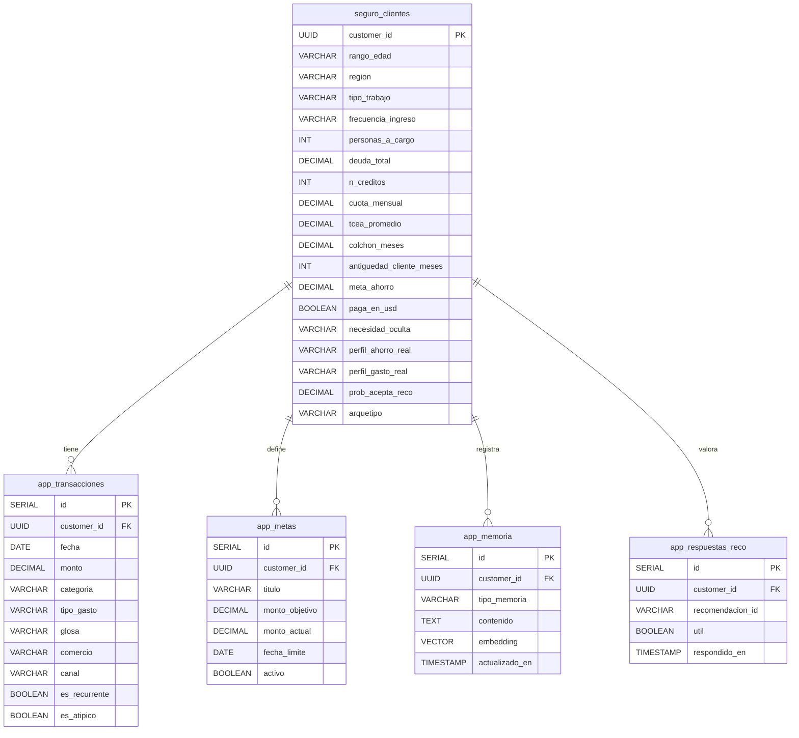

# Arquitectura de Datos y Flujos (Lucas)

Este documento describe la arquitectura de datos del copiloto **Lucas**, incluyendo el diagrama entidad-relación (ERD) para los esquemas `seguro` y `app`, y el diagrama de flujo del pipeline de generación de datos sintéticos.

---

## 1. Diagrama Entidad-Relación (ERD)

A continuación se muestra el esquema relacional en PostgreSQL, estructurado en los esquemas `seguro` (datos protegidos de clientes) y `app` (transacciones, memoria y respuestas con Row Level Security - RLS).



---

## 2. Flujo del Pipeline de Datos Sintéticos e Ingesta

El siguiente diagrama muestra el flujo desde la generación de datos estratificados con semilla fija hasta la carga validada en PostgreSQL con Pydantic y reglas de seguridad ISO 27001.

```mermaid
graph TD
    A[Inicio: python data/generator.py --seed 42] --> B[Definición de Arquetipos & Distribuciones Calibradas]
    B --> C[Bootstrap Estratificado (~500 Clientes x 12 Meses)]
    C --> D[Inyección de Calendario Peruano & Escenarios Difíciles]
    D --> E[Generación de Tabular, Glosas y Sentimiento]
    E --> F[Salida de Datos en data/sample/]
    F --> G[Validación Pydantic & Deduplicación src/ingest/]
    G --> H[Carga a PostgreSQL (Esquemas seguro y app)]
    H --> I[Aplicación de RLS y Roles (lucas_app, lucas_agente)]
    I --> J[Fin: make data completo y verificado]
```

---

## 3. Clasificación de Información (ISO/IEC 27001 - 5.12)

| Nivel | Esquema / Tabla | Descripción |
|---|---|---|
| **Sensible** | `seguro.clientes` | Datos demográficos y métricas crediticias cifradas con RLS estricto. |
| **Interna** | `app.transacciones`, `app.metas`, `app.memoria` | Movimientos, metas y resúmenes de interacción del usuario. |
| **Pública** | Documentación RAG (`docs/rag/`) | PDFs educativos y metadatos con licencia verificada. |
