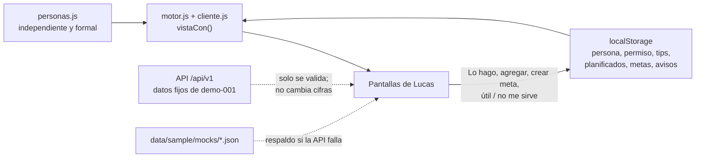
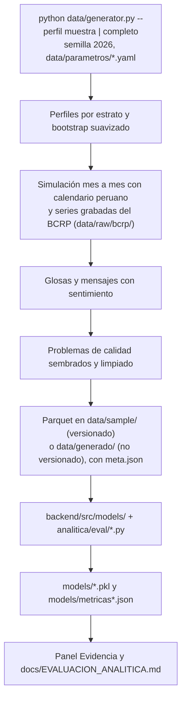

# Arquitectura de datos (MVP)

Qué datos usa el MVP de Lucas, de dónde salen y por dónde pasan. La vista general está en [ARCHITECTURE.md](../ARCHITECTURE.md); si este documento y ARCHITECTURE.md se contradicen, manda ARCHITECTURE.md. Las columnas de cada tabla están en [data/dictionary.md](../data/dictionary.md).

## 1. Dos caminos de datos

El MVP tiene dos caminos que no se cruzan:

| Camino | Para qué | Datos | Dónde se ven |
|---|---|---|---|
| **Demo del cliente** | Las pantallas de Lucas | Dos personas sintéticas escritas en `frontend/src/motor/personas.js` y lo que cada persona elige, guardado en el navegador | Banca, Resumen, Gastos, Qué viene, Avisos, Metas, Salud y Chat |
| **Analítica** | Entrenar y medir cada técnica contra su baseline | 500 clientes sintéticos del generador, en Parquet | Panel Evidencia, vía `models/metricas*.json` |

## 2. Camino de la demo

Lo que el navegador guarda (claves de `frontend/src/sesion.js` y `frontend/src/lucas/avisosGuardados.js`):

| Qué | Cuándo se borra |
|---|---|
| Persona elegida y permiso de cada persona | El permiso, al retirarlo en Preferencias |
| Tips elegidos, gastos e ingresos planificados y metas | Al retirar el permiso de esa persona o al cambiar de persona |
| Avisos ya mostrados por semana y respuestas «útil / no me sirve» | Con «borrar mis avisos guardados» en Preferencias |
| Tema claro u oscuro y guía ya vista | No se borran; no son datos de la persona |

Cada lectura valida la forma de lo guardado y descarta lo roto, así una versión vieja no tumba la app.

## 3. Camino de la analítica

Tablas que produce el generador:

| Tabla | Qué tiene |
|---|---|
| `clientes` | Un cliente por fila: perfil, deuda, colchón y etiquetas de referencia |
| `transacciones` | Movimientos con fecha, monto, comercio ficticio, canal y glosa |
| `saldo_diario` | Saldo de cada cliente por día |
| `panel_mensual` | Ingresos, gastos y neto por cliente y mes |
| `eventos` | Grati, CTS, feriados y campañas con su fuerza diaria |
| `contexto_diario`, `macro_mensual` | Calendario e indicadores del BCRP |
| `mensajes` | Mensajes del usuario con su sentimiento |
| `etiquetas_calidad` | Qué atípicos, duplicados y faltantes se sembraron |

`meta.json` guarda la semilla, el número de clientes, las versiones de Python, numpy y pandas y la huella de los parámetros. `data/QUALITY.md` es el informe de calidad generado por `backend/src/generador/reporte.py`.

### Sin fuga en la evaluación

`backend/src/models/columnas.py` dice qué columnas puede ver un modelo. Las columnas de uso `etiqueta` (verdad de referencia) e `interna` (cómo se generó el dato) nunca entran a un modelo. El impacto en S/ (`backend/src/models/impacto.py`) se mide repitiendo las decisiones sobre los flujos reales del periodo de prueba, no con el pronóstico que las eligió.

## 4. Clasificación (ISO/IEC 27001, control 5.12)

Todo es dato sintético, sin nombres, DNI, teléfonos, cuentas ni marcas reales.

| Nivel | Datos | Nota |
|---|---|---|
| Interno | `data/sample/`, `data/generado/`, lo guardado en el navegador | En un banco real, `clientes` y las transacciones serían sensibles |
| Público | `models/metricas*.json`, `data/sample/mocks/`, `docs/rag/` (PDF con licencia verificada) | Se publican en el repo y en Evidencia |
| Secreto | `GEMINI_API_KEY` en `.env` | Fuera del repo; Gemini está apagado por defecto |

`db/init.sql` tiene listo el esquema de PostgreSQL (esquemas `seguro`, `app` y `rag`, roles, RLS y pgcrypto) para cuando la API lea datos de clientes. En el MVP ningún componente se conecta a la base.
