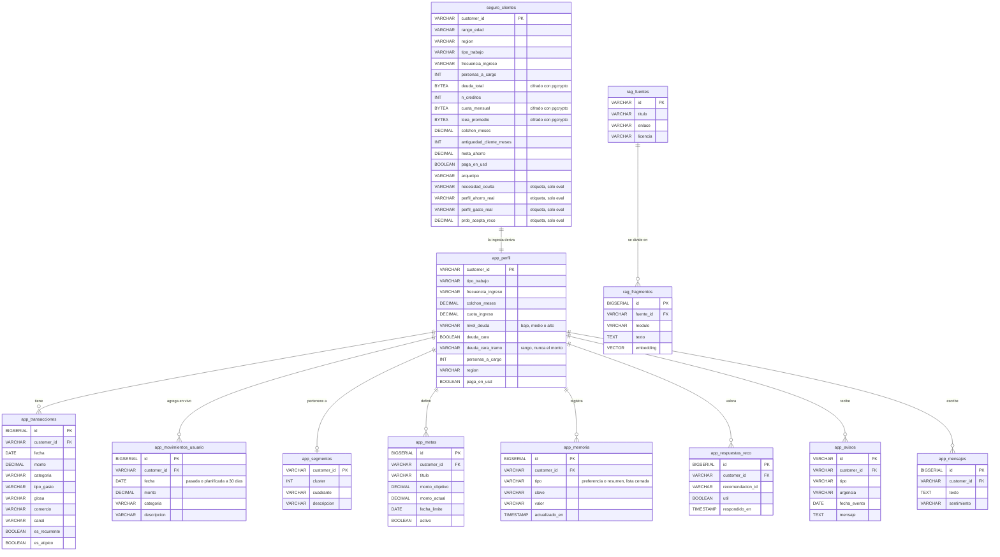
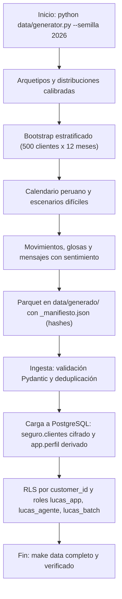

# Arquitectura de Datos y Flujos (Lucas)

Este documento describe la arquitectura de datos del copiloto **Lucas**, incluyendo el diagrama entidad-relación (ERD) para los esquemas `seguro`, `app` y `rag`, y el diagrama de flujo del pipeline de generación de datos sintéticos.

---

## 1. Diagrama Entidad-Relación (ERD)

A continuación se muestra el esquema relacional en PostgreSQL, estructurado en los esquemas `seguro` (datos protegidos de clientes), `app` (datos derivados y de uso, con Row Level Security por `customer_id`) y `rag` (fuentes públicas del RAG). Sigue la sección 5 de [ARCHITECTURE.md](../ARCHITECTURE.md); si cambian, manda ARCHITECTURE.md.

`app.perfil` es la frontera de privacidad (ARCHITECTURE.md, sección 5.1): la ingesta es la única que lee `seguro.clientes` y escribe en `app.perfil` solo valores derivados. Las tablas de `app` cuelgan de `app.perfil`, nunca de `seguro.clientes`. `app.memoria` guarda pares `clave`/`valor` de listas cerradas, nunca texto libre del usuario. El `customer_id` es un código sintético (`C00001`), no un UUID.

---

## 2. Flujo del Pipeline de Datos Sintéticos e Ingesta

El siguiente diagrama muestra el flujo desde la generación de datos estratificados con semilla fija hasta la carga validada en PostgreSQL con Pydantic y reglas de seguridad ISO 27001.

Los pasos A a F existen hoy (`src/generador/`). La ingesta y la carga a PostgreSQL (G a I) están planificadas en MG-02 y MI-03 y todavía no tienen código. `data/generado/` está en `.gitignore`: los datos se regeneran con la semilla y no se suben al repo.

---

## 3. Clasificación de Información (ISO/IEC 27001 - 5.12)

| Nivel | Esquema / Tabla | Descripción |
|---|---|---|
| **Sensible** | `seguro.clientes` | Datos demográficos y de deuda; montos cifrados con pgcrypto. Ni `lucas_app` ni `lucas_agente` tienen permiso: solo la ingesta (`lucas_admin`) y `eval/` (`lucas_batch`). |
| **Interna** | `app.perfil`, `app.transacciones`, `app.movimientos_usuario`, `app.segmentos`, `app.metas`, `app.memoria`, `app.respuestas_reco`, `app.avisos`, `app.mensajes` | Datos derivados y de uso, con RLS por `customer_id`. `app.perfil` no guarda montos de deuda. |
| **Pública** | `rag.fuentes`, `rag.fragmentos` y `docs/rag/` | PDFs educativos y metadatos con licencia verificada. |
