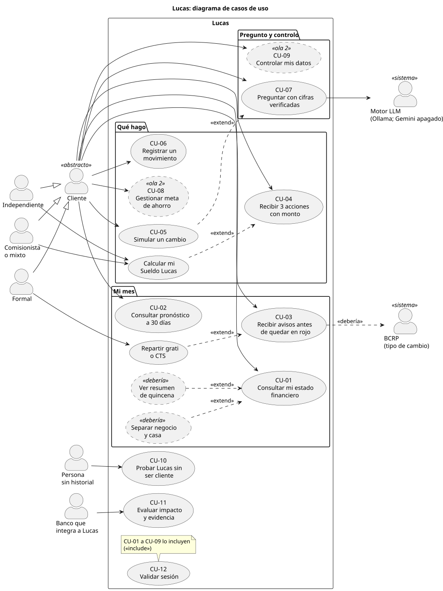

# Casos de uso de Lucas (MVP)

Versión 2.0, 2026-11-14. Responsable: Michael (arquitectura). Describe solo lo que hace el MVP de `develop`.

## Índice

1. [Propósito y alcance](#1-propósito-y-alcance)
2. [Actores](#2-actores)
3. [Diagrama](#3-diagrama)
4. [Fichas](#4-fichas)
   [CU-01](#cu-01--entrar-a-lucas-desde-mi-banca),
   [CU-02](#cu-02--consultar-mi-estado),
   [CU-03](#cu-03--consultar-qué-viene),
   [CU-04](#cu-04--recibir-avisos-antes-de-quedar-en-rojo),
   [CU-05](#cu-05--elegir-tips-con-monto),
   [CU-06](#cu-06--planificar-un-gasto-o-un-ingreso),
   [CU-07](#cu-07--gestionar-una-meta-de-ahorro),
   [CU-08](#cu-08--preguntar-en-el-chat),
   [CU-09](#cu-09--controlar-mis-datos),
   [CU-10](#cu-10--evaluar-impacto-y-evidencia)
5. [Matriz de trazabilidad](#5-matriz-de-trazabilidad)

## 1. Propósito y alcance

Este documento modela con casos de uso UML lo que hace el MVP de Lucas para cada actor. Responde a una sola pregunta del cliente: «¿cuánto puedo gastar o ahorrar este mes sin quedarme en rojo antes de mi próximo ingreso, y qué cambio me conviene más?».

Lucas es un compañero bancario, no un chatbot:

- **Se adelanta**: ve venir el rojo antes del cobro y avisa a 7 días o menos (CU-01, CU-04).
- **Propone acciones con monto** que el cliente prueba antes de decidir: tips con «Lo hago», cuánto apartar al cobrar, simulador y metas (CU-05, CU-06, CU-07).
- **Fideliza**: el cliente vuelve porque el aviso le llega antes del problema y porque cada cobro ve cuánto puede apartar (CU-04, CU-05).
- **Le rinde al banco**: el banco ve en S/ cuánto mejora cada cliente y qué gana él (CU-10).

La fuente de verdad son las historias de [historias.md](../.claude/planes/historias.md); si un caso y una historia chocan, manda la historia. Las 18 historias se agrupan en 10 casos. La [matriz](#5-matriz-de-trazabilidad) dice dónde quedó cada historia y qué pruebas la verifican.

**Cómo está armado el MVP.** Lucas vive dentro de Banco Vértice, una banca ficticia (`frontend/`). Todas las cifras de cliente salen del motor del front (`frontend/src/motor/`), así que ninguna pantalla contradice a otra. Lo que la persona elige se guarda en el navegador. El front también lee la API FastAPI (`backend/src/api/`), pero hoy esa API devuelve datos fijos de otra persona y no cambia ninguna cifra visible. El detalle está en [ARCHITECTURE.md](../ARCHITECTURE.md).

**Cómo leer una ficha**

- Los pasos del flujo principal van numerados. Un flujo alterno `4a` sale del paso 4 y vuelve al flujo principal salvo que diga otra cosa. Una excepción `E2.1` sale del paso 2 y termina el caso.
- Las cifras de ejemplo son las de la persona de la demo: independiente, hoy 14 de noviembre, cobra S/ 2,000 el 30 de noviembre y su peor caso es −S/ 60 entre el 28 y el 29.
- La palanca `P#` dice cómo gana el banco cuando el cliente gana, según [rentabilidad-impacto.md](../.claude/reglas/rentabilidad-impacto.md):

| Palanca | Qué gana el banco | Se ve en el MVP con | Casos |
|---|---|---|---|
| P1 | Captación de ahorro | S/ que se pueden apartar al cobrar y metas | CU-02, CU-05, CU-06, CU-07 |
| P2 | Principalidad y retención | Tarjeta de Lucas en la banca y avisos (máximo 3 por semana) | CU-01, CU-02, CU-04, CU-09 |
| P3 | Menos mora | Días en rojo evitados | CU-03, CU-04, CU-05, CU-06 |
| P5 | Venta cruzada idónea | Ningún tip ni respuesta sugiere crédito | CU-05, CU-08 |
| P6 | Menos costo de atención | Preguntas respondidas en el chat | CU-08 |

- Todas las fichas cumplen además los criterios comunes de las historias: cada cifra sale del motor, los montos van en S/ con banda y peor caso, todo tip o aviso muestra efecto en S/, «¿Por qué?» y «Tú decides», contraste AA y funcionamiento sin internet ni API.

## 2. Actores

| Actor | Tipo | Descripción |
|---|---|---|
| Cliente | Principal, abstracto | Persona con cuenta en Banco Vértice. Lo concretan dos actores que heredan sus casos |
| Independiente | Principal (hereda de Cliente) | Cobra por recibo por honorarios de 2 clientes; el monto cambia cada mes. Es la persona de la demo |
| Formal | Principal (hereda de Cliente) | Sueldo fijo por quincena |
| Banco que integra a Lucas | Principal | Equipo de producto que evalúa licenciar Lucas. En la demo lo representa el jurado |

El motor del front y la API forman parte de Lucas; no son actores. El chat no depende de un LLM en el MVP: responde con plantillas (CU-08).

## 3. Diagrama

Fuente: [diagramas/casos-uso.puml](diagramas/casos-uso.puml).

- `<<include>>`: el caso siempre ejecuta al otro. CU-02 a CU-09 incluyen CU-01 porque todos necesitan una persona elegida con permiso dado; para que el diagrama se lea, esas 8 flechas se resumen en la nota junto a CU-01.
- `<<extend>>`: «Explicármelo fácil» extiende CU-03 y CU-05 cuando el cliente pulsa el botón.

## 4. Fichas

### CU-01 · Entrar a Lucas desde mi banca

| Campo | Valor |
|---|---|
| Actor principal | Cliente |
| Historias | HU-26, HU-23 |
| Palanca | P2 |
| Pantallas | `/ingresar`, `/consentimiento`, `/banca` |
| Precondiciones | Ninguna |
| Disparador | El cliente abre la app, o un caso que lo incluye necesita a Lucas activo |
| Postcondición de éxito | El cliente está en Lucas con su persona elegida y su permiso dado |
| Garantía mínima | Sin permiso no se muestra nada de Lucas |

**Flujo principal**

1. El cliente abre Banco Vértice y ve el ingreso con datos ficticios ya cargados.
2. El cliente elige su persona (independiente o formal) e ingresa. Elegir la persona es el inicio de sesión de la demo.
3. Lucas revisa si esa persona ya dio su permiso.
4. Lucas muestra la banca: saldo, cuentas, accesos, los 3 últimos movimientos y su tarjeta antes de los accesos.
5. La tarjeta dice «Lucas te avisa» si el rojo está a 7 días o menos, y «Lucas lo ve venir» si está más lejos (en la demo, 14 días).
6. El cliente toca la tarjeta o el botón de Lucas al centro de la barra y entra al Resumen.
7. Si es su primera entrada al Resumen, Lucas muestra una guía de 3 pasos con «Saltar».

**Flujos alternos**

- **3a.** La persona no dio su permiso: la tarjeta dice «Activa Lucas». Al tocarla, Lucas muestra qué datos usa, para qué, que son sintéticos y cómo retirarlo.
  - **3a1.** El cliente pulsa «Acepto, activar Lucas»: Lucas guarda el permiso de esa persona y vuelve a donde iba (paso 4 o la pantalla que pidió).
  - **3a2.** El cliente pulsa «Ahora no»: la banca queda sin Lucas y el caso termina.
- **4a.** El cliente oculta los montos: la banca muestra `S/ ••••`.
- **5a.** Con los tips elegidos ya no hay rojo: la tarjeta dice que llega a su cobro sin quedar en rojo.
- **7a.** El cliente pulsa «?» en cualquier pestaña de Lucas: vuelve a ver la guía.

**Excepciones**

- **E2.1.** Lo guardado en el navegador está roto: Lucas entra con la persona de la demo sin romperse.

**Reglas de negocio**

- El permiso es de cada persona: el del independiente no vale para el formal.
- El formulario de ingreso es solo visual: sus campos vienen llenos y bloqueados para que nadie escriba datos reales.

**Pruebas:** `frontend/pruebas/sesion.test.js`; `frontend/e2e/pantallas.spec.js` («ingreso, permiso, banca, Lucas y guía de primera vez», «consentimiento: "Ahora no"…», «la banca puede ocultar los montos», «el botón "?" abre la guía desde cualquier pestaña de Lucas»).

### CU-02 · Consultar mi estado

| Campo | Valor |
|---|---|
| Actor principal | Cliente |
| Historias | HU-01, HU-02 |
| Palanca | P1, P2 |
| Pantallas | Salud (`/lucas/salud`), Gastos (`/lucas/gastos` y su detalle) |
| Precondiciones | Lucas activo (incluye CU-01) |
| Disparador | El cliente abre «Tu salud» desde el Resumen o la pestaña Gastos |
| Postcondición de éxito | El cliente sabe qué tan sana está su plata, en qué se le va y por dónde empezar |
| Garantía mínima | Toda cifra sale del motor con los datos de la persona elegida |

**Flujo principal**

1. El cliente abre Salud.
2. Lucas muestra un puntaje de 0 a 100, promedio de 4 partes (colchón, deudas, regularidad del ingreso y control del gasto), con una frase por parte y la nota «Cálculo provisional».
3. El cliente toca una parte y Lucas lo lleva donde puede mejorarla: tips, apartar al cobrar, próximos pagos o chat.
4. El cliente abre Gastos.
5. Lucas muestra lo gastado en los últimos 30 días en un gráfico circular con su porcentaje (hasta 5 categorías más «Otros»).
6. En el detalle, Lucas compara cada categoría con su promedio de 3 meses y lista las suscripciones con monto, día de cobro y cuánto se usan.

**Flujos alternos**

- **3a.** El cliente ya eligió tips que evitan días en rojo: el puntaje sube.
- **6a.** El cliente pausa una suscripción que casi no usa: la pausa queda elegida también como tip (CU-05).
- **6b.** Una categoría está a S/ 5 o menos de su promedio: Lucas dice «como siempre».

**Reglas de negocio**

- El puntaje nunca baja cuando el cliente elige un tip.
- Los porcentajes del gráfico suman 100.

**Pruebas:** `frontend/pruebas/motor.test.js` («la salud sube…»), `frontend/pruebas/categorias.test.js`; `frontend/e2e/pantallas.spec.js` («cada parte de la salud lleva a una acción», «Gastos compara cada categoría con el promedio», «MusiKa se pausa desde Suscripciones…»).

### CU-03 · Consultar qué viene

| Campo | Valor |
|---|---|
| Actor principal | Cliente |
| Historias | HU-03, HU-23 («Explícamelo fácil») |
| Palanca | P3 |
| Pantalla | Qué viene (`/lucas/que-viene`) |
| Precondiciones | Lucas activo (incluye CU-01) |
| Disparador | El cliente abre la pestaña Qué viene |
| Postcondición de éxito | El cliente sabe cuánto tendrá cada día hasta su cobro y qué día podría quedar en rojo |
| Garantía mínima | La incertidumbre siempre se muestra; nunca un saldo futuro como cifra exacta |
| Puntos de extensión | `explicar` en el paso 3 |

**Flujo principal**

1. El cliente abre Qué viene.
2. Lucas pronostica el saldo diario hasta el cobro con su banda, con los tips elegidos y lo planificado.
3. Lucas muestra el gráfico en línea punteada con la banda y etiquetas directas: «Hoy», «Cobro» y «Peor caso −S/ 60».
4. Lucas lista los pagos y cobros que vienen.
5. El cliente decide si reacciona: elegir tips (CU-05) o simular un gasto o ingreso (CU-06).

**Flujos alternos**

- **2a.** El cliente cambia a «30 días»: Lucas muestra también los pagos de diciembre.
- **3a.** El peor caso no queda en rojo: Lucas muestra solo el saldo con su banda.

**Extensiones**

- **Explicármelo fácil** (HU-23), en `explicar`: el cliente pulsa «Explícamelo fácil» y Lucas explica la pantalla en frases cortas, con «peor caso» en palabras simples y sin cifras nuevas.

**Reglas de negocio**

- Un gasto extra baja el peor caso en ese mismo monto y nunca lo sube.
- El mismo día, la banda del independiente es más ancha que la del formal, porque su cobro cambia de un mes a otro.

**Pruebas:** `frontend/pruebas/motor.test.js`, `frontend/pruebas/personas.test.js` («la banda del independiente es más ancha…»), `frontend/pruebas/grafico.test.js`, `frontend/pruebas/explicaciones.test.js`; `frontend/e2e/pantallas.spec.js` («el gráfico de Qué viene…», «Qué viene cambia de periodo…», «"Explícamelo fácil" en …»).

### CU-04 · Recibir avisos antes de quedar en rojo

| Campo | Valor |
|---|---|
| Actor principal | Cliente |
| Historias | HU-04, HU-17 («útil / no me sirve») |
| Palanca | P2, P3 |
| Pantallas | Bandeja de Avisos (`/lucas/avisos`, campana), tarjeta de la banca, aviso del Resumen |
| Precondiciones | Lucas activo (incluye CU-01) |
| Disparador | Al armar la vista, Lucas detecta un riesgo antes del próximo cobro o un pago con algo que hacer |
| Postcondición de éxito | El cliente ve, días antes de que pase, lo que le conviene atender, con monto y acción |
| Garantía mínima | Volver a entrar no duplica avisos ni gasta el tope semanal |

**Flujo principal**

1. El cliente entra a Lucas o abre la campana.
2. Lucas calcula el peor caso hasta el próximo cobro y el día en que quedaría en rojo.
3. El rojo cae entre 3 y 7 días: Lucas arma un aviso normal con el monto en riesgo.
4. Lucas junta los avisos de la semana (lunes a domingo) y deja como máximo 3: el de riesgo, que tiene lugar reservado, y los 2 de mayor efecto en S/.
5. Lucas guarda en el navegador qué avisos ya mostró esa semana.
6. Lucas muestra cada aviso con «Urgente» o «Aviso» en texto, la acción y un enlace a ella.
7. El cliente abre «¿Por qué?» y ve los datos usados, el supuesto y qué tan seguro es (alta, media o baja).
8. El cliente decide: seguir el enlace a la acción, marcar el aviso o no hacer nada.

**Flujos alternos**

- **3a.** El rojo cae a 0, 1 o 2 días: el aviso es urgente.
- **3b.** El rojo cae a más de 7 días: no hay aviso. El riesgo se ve en Qué viene y la banca dice «Lucas lo ve venir».
- **3c.** El peor caso no queda en rojo: no hay aviso de riesgo y su lugar queda libre para otros avisos.
- **3d.** Un pago se cobra en los próximos 7 días y hay un tip que lo pausa: se arma un aviso de pago. Los pagos sin algo que hacer no avisan.
- **5a.** Un gasto nuevo (CU-06) adelanta el rojo antes del mismo cobro: Lucas actualiza el mismo aviso con su fecha y monto, sin gastar otro lugar.
- **5b.** Un aviso ya se mostró esta semana: se queda aunque llegue otro de más efecto.
- **8a.** El cliente marca «útil» o «no me sirve»: Lucas lo guarda en el navegador y lo recuerda al volver.
- **8b.** El cliente usa el bloque de demo de la bandeja: prueba la regla sin gastar el tope de la semana real.

**Reglas de negocio**

- Máximo 3 avisos por semana, con lugar reservado para el de riesgo; un solo aviso por hueco antes de cada cobro.
- «Qué tan seguro» compara lo más probable con el peor caso del pronóstico.

**Pruebas:** `frontend/pruebas/avisos.test.js`; `frontend/e2e/pantallas.spec.js` («Avisos: …»).

### CU-05 · Elegir tips con monto

| Campo | Valor |
|---|---|
| Actor principal | Cliente |
| Historias | HU-06, HU-07, HU-23 («Explícamelo fácil») |
| Palanca | P1, P3, P5 |
| Pantalla | Resumen (`/lucas/resumen`) |
| Precondiciones | Lucas activo (incluye CU-01) |
| Disparador | El cliente abre el Resumen |
| Postcondición de éxito | El cliente eligió los cambios que lo sacan del rojo y sabe cuánto puede apartar al cobrar |
| Garantía mínima | Ningún tip sugiere crédito, tarjeta ni préstamo |
| Puntos de extensión | `explicar` en el paso 2 |

**Flujo principal**

1. El cliente abre el Resumen.
2. Lucas muestra cuánto gasta al día, el aviso del peor día y los «Tips para tu día más justo», ordenados de mayor a menor efecto.
3. Cada tip dice «+S/ X para tu día más justo», «Evitas N días en rojo» y su «¿Por qué?».
4. El cliente pulsa «Lo hago» en un tip.
5. Lucas recalcula el aviso, el gráfico, la banca, la salud y el chat con ese cambio, y lo guarda en el navegador.
6. Lucas muestra el seguimiento del tip («Llevas 0 de 2 veces en RapiFood hasta el 30 nov»).
7. Lucas muestra en «Después de cobrar» cuánto puede apartar el día del cobro sin volver al rojo.
8. El cliente decide; puede llevar ese monto a una meta (CU-07).

**Flujos alternos**

- **4a.** El cliente elige los 3 tips de la demo: el peor caso pasa de −S/ 60 a +S/ 12 y los días en rojo, de 2 a 0.
- **4b.** El cliente vuelve a pulsar «Lo hago»: quita el tip y todo se recalcula.
- **7a.** No hay margen después del cobro: Lucas dice «Al cobrar, todavía no te conviene apartar» y no propone nada.

**Extensiones**

- **Explicármelo fácil** (HU-23), en `explicar`: igual que en CU-03.

**Reglas de negocio**

- Cada tip se mide sobre los otros ya elegidos, para que sus efectos se puedan sumar; las tarjetas no cambian de orden al elegir.
- El apartado es el mayor monto en múltiplos de S/ 10 que no deja en rojo ni en el peor caso; S/ 10 más ya dejaría en rojo.
- Elegir tips nunca reduce lo que se puede apartar (en la demo: S/ 40 sin tips, S/ 150 con los 3).

**Pruebas:** `frontend/pruebas/motor.test.js`, `frontend/pruebas/personas.test.js`; `frontend/e2e/pantallas.spec.js` («"Lo hago" recalcula el plan en todas las pantallas y se recuerda»); `frontend/e2e/guion-demo.spec.js`.

### CU-06 · Planificar un gasto o un ingreso

| Campo | Valor |
|---|---|
| Actor principal | Cliente |
| Historias | HU-08, HU-09 |
| Palanca | P1, P3 |
| Pantalla | Qué viene, «Simular un gasto o ingreso» |
| Precondiciones | Lucas activo (incluye CU-01) |
| Disparador | El cliente sabe que viene un gasto o un ingreso que Lucas no conoce |
| Postcondición de éxito | El cliente vio cómo cambia su mes y, si quiso, lo agregó a su pronóstico |
| Garantía mínima | Nada se guarda hasta «Agregar a mi pronóstico»; un movimiento inválido no se guarda |

**Flujo principal**

1. El cliente abre «Simular un gasto o ingreso» en Qué viene.
2. El cliente indica si es gasto o ingreso, el concepto, el monto y la fecha.
3. Lucas valida el monto y que la fecha esté entre mañana y hoy + 30 días.
4. Lucas recalcula en vivo la banda, el peor caso y los días en rojo, sin guardar nada (en la demo: S/ 450 el 5 dic, días en rojo 2 → 12).
5. El cliente pulsa «Agregar a mi pronóstico».
6. Lucas guarda el movimiento en el navegador y lo descuenta el día exacto, no hoy.
7. Todas las pantallas se recalculan; si deja en rojo, aparece en el aviso del Resumen (CU-04).

**Flujos alternos**

- **3a.** El gasto coincide con un pago conocido (mismo comercio y monto parecido): Lucas avisa que ya lo tiene contado.
- **4a.** El gasto deja en rojo: Lucas dice cuánto cabe ese día sin sumar días en rojo o, si nada cabe, cuánto después del cobro.
- **4b.** Es un ingreso antes del día más justo: puede quitar el rojo.
- **5a.** El cliente no lo agrega: el pronóstico queda como estaba.

**Excepciones**

- **E3.1.** El monto es 0, negativo, texto, vacío, con más de dos decimales o sobre el tope: Lucas lo rechaza con un mensaje junto al campo.
- **E3.2.** La fecha es hoy, pasada, a más de 30 días o no existe: Lucas la rechaza con un mensaje claro. Planificar es solo hacia adelante.

**Pruebas:** `frontend/pruebas/planificar.test.js`; `frontend/e2e/simulador-metas.spec.js` («simulador: …»).

### CU-07 · Gestionar una meta de ahorro

| Campo | Valor |
|---|---|
| Actor principal | Cliente |
| Historias | HU-16 |
| Palanca | P1 |
| Pantalla | Metas (`/lucas/metas`, desde «Tus metas» del Resumen) |
| Precondiciones | Lucas activo (incluye CU-01) |
| Disparador | El cliente abre «Tus metas» o «Llévalo a una meta» |
| Postcondición de éxito | El cliente tiene una meta con un aporte por cobro que no lo deja en rojo |
| Garantía mínima | Una meta nunca se salta estados |

**Flujo principal**

1. El cliente abre Metas y pulsa «Crea tu primera meta».
2. El cliente escribe el nombre, el monto, lo que ya tiene ahorrado y la fecha (por defecto, 31 de diciembre).
3. Lucas valida los datos.
4. Lucas calcula el aporte por cobro a partir del apartado de CU-05, la fecha en que llegaría y la confianza (alta, media o baja).
5. Lucas crea la meta en estado **creada** y la guarda en el navegador.
6. El día del cobro, el cliente pulsa «Ya aparté»: la meta pasa a **en curso** y el plan sigue con los cobros que faltan.
7. Al llegar al monto, la meta pasa a **cumplida**.

**Flujos alternos**

- **4a.** Con el apartado de hoy no llega a la fecha: Lucas dice cuánto junta a esa fecha y cuándo llegaría.
- **4b.** No hay margen al cobrar: Lucas dice que hoy no conviene apartar para esta meta.
- **4c.** Hay otras metas abiertas: el apartado se reparte en el orden en que se crearon; si no alcanza, esta espera su turno.
- **4d.** No hay cobros antes de la fecha: Lucas no promete llegar ni propone aporte.

**Excepciones**

- **E3.1.** Falta el nombre, el monto no es válido, lo ahorrado no es menor que la meta o la fecha cae antes del próximo cobro: Lucas lo rechaza con un mensaje junto al campo.

**Reglas de negocio**

- Estados: creada → en curso → cumplida, sin saltos; una meta que se cumple de golpe pasa igual por «en curso».
- El aporte no crea días en rojo y nunca pasa de lo que falta.
- La confianza baja si la meta o la llegada pasan de unos 3 meses, porque el pronóstico cubre 30 días.

**Pruebas:** `frontend/pruebas/metas.test.js`; `frontend/e2e/simulador-metas.spec.js` («metas: …»).

### CU-08 · Preguntar en el chat

| Campo | Valor |
|---|---|
| Actor principal | Cliente |
| Historias | HU-10, HU-11 |
| Palanca | P5, P6 |
| Pantalla | Chat (`/lucas/chat`) |
| Precondiciones | Lucas activo (incluye CU-01) |
| Disparador | El cliente escribe una pregunta o elige una pregunta frecuente |
| Postcondición de éxito | El cliente recibe una respuesta en palabras simples con cifras del motor |
| Garantía mínima | Lucas nunca mueve dinero, nunca recomienda comprar o vender dólares ni invertir, y nunca muestra una cifra que no salga del motor |

**Flujo principal**

1. El cliente escribe su pregunta.
2. Lucas la lee junto con lo que se habló antes en el chat.
3. Lucas reconoce el tema: si llega al cobro, si le alcanza un gasto, cuánto puede ahorrar, en qué gasta más o una meta.
4. Lucas calcula la respuesta con el motor, usando los tips elegidos.
5. Lucas responde en frases cortas y pone las cifras en un bloque «Calculado con tus datos», con «Tú decides».

**Flujos alternos**

- **3a.** La pregunta es «¿llego a fin de mes si gasto S/ 150 en un regalo?»: Lucas lo prueba con el motor. Si el gasto supera el saldo o el peor caso ya está en rojo, nunca responde «Sí, te alcanza».
- **3b.** La pregunta es una meta («quiero juntar para un carro a fin de año»): Lucas arma el plan con el mismo cálculo de Metas (CU-07) y dice qué evitar. Si falta el monto o la fecha, los pide.
  - **3b1.** El precio está en dólares: Lucas lo pasa a soles con el tipo de cambio de referencia y su fecha, sin recomendar comprar ni vender.
- **3c.** El cliente dice «explícame más» o «¿por qué?»: Lucas explica el cálculo del último tema.
- **3d.** El cliente escribe un monto suelto: Lucas pregunta si es una compra o una meta.
- **3e.** El cliente saluda: Lucas saluda sin cifras.
- **4a.** El front se levantó con `VITE_CHAT_AGENTE=si`: Lucas pregunta al agente por `POST /api/v1/chat` y muestra ✓ solo en las cifras que el agente verificó. Hoy la API devuelve un mock sin verificar, así que Lucas sigue en el paso 4 con la plantilla.
  - **4a1.** El agente falla, tarda más de 12 s o no verificó sus cifras: Lucas lo dice («No pude hablar con el agente de Lucas. Te respondo con mis cálculos de siempre.») y responde con la plantilla.

**Excepciones**

- **E3.1.** El cliente pide «transfiere S/ 500 a mi primo», «compra dólares hoy» o «¿en qué acción invierto?»: Lucas responde que eso no lo hace y ofrece decir cuánto margen tiene hasta su cobro. El pedido no sale a la red.
- **E3.2.** Lucas no entiende la pregunta: lo dice sin inventar cifras y sugiere usar las preguntas frecuentes.

**Reglas de negocio**

- Las cifras salen del motor, nunca del texto de la pregunta.
- Ninguna respuesta sugiere crédito, tarjeta ni préstamo.
- «El carro está 14 000 dólares» es un precio, no un pedido de comprar dólares.

**Pruebas:** `frontend/pruebas/respuestas.test.js`, `frontend/pruebas/clienteChat.test.js`; `frontend/e2e/pantallas.spec.js` («el chat responde "Calculado con tus datos" y no da asesoría», «si el agente falla…», «si el agente no verificó…», «el chat recuerda la meta…»).

### CU-09 · Controlar mis datos

| Campo | Valor |
|---|---|
| Actor principal | Cliente |
| Historias | HU-17, HU-18, HU-23 |
| Palanca | P2 |
| Pantallas | Lo que aprendí de ti (`/lucas/aprendido`), Más → Preferencias (`/preferencias`) |
| Precondiciones | Haber ingresado (CU-01) |
| Disparador | El cliente quiere corregir lo que Lucas cree de él o borrar lo que recuerda |
| Postcondición de éxito | Lo que Lucas recordaba de esa persona queda corregido o borrado |
| Garantía mínima | Nunca se toca lo guardado de la otra persona |

**Flujo principal**

1. El cliente abre «Lo que aprendí de ti» desde el Resumen.
2. Lucas muestra cada dato que aprendió (por ejemplo, cuándo y cuánto cobra) y de dónde lo sacó.
3. El cliente responde «¿Es correcto?»: «Sí» lo confirma y «No» lo marca como por revisar, con «Deshacer».
4. El cliente abre Más → Preferencias → Privacidad.
5. El cliente retira el permiso de Lucas y lo confirma.
6. Lucas se apaga para esa persona y borra sus tips, sus gastos planificados y sus metas.

**Flujos alternos**

- **4a.** El cliente pulsa borrar sus avisos guardados: Lucas borra el registro de avisos y las respuestas «útil / no me sirve», y dice «Listo, se borró.».
- **4b.** El cliente cambia de persona en Preferencias: Lucas descarta los tips, lo planificado y las metas de la anterior.
- **4c.** El cliente cambia a modo oscuro: solo cambia la apariencia.

**Excepciones**

- **E6.1.** Lo guardado en el navegador está roto: Lucas lo descarta y la app sigue.

**Reglas de negocio**

- Todo lo que Lucas recuerda vive en el navegador; nada se envía a un servidor.
- Las respuestas de «¿Es correcto?» quedan en la pantalla y no cambian los tips siguientes.

**Pruebas:** `frontend/pruebas/sesion.test.js`; `frontend/e2e/pantallas.spec.js` («Resumen: confirmar lo aprendido…», «responder "No" marca el dato como por revisar…», «retirar el permiso desde Preferencias…»), `frontend/e2e/simulador-metas.spec.js` («retirar el permiso olvida lo planificado y las metas», «datos rotos guardados en el navegador no tumban la app»).

### CU-10 · Evaluar impacto y evidencia

| Campo | Valor |
|---|---|
| Actor principal | Banco que integra a Lucas |
| Historias | HU-14, HU-20 |
| Palanca | Todas |
| Pantalla | Evidencia (`/evidencia`, también desde Más → Preferencias → Para el jurado) |
| Precondiciones | Existen los `models/metricas*.json` generados con los scripts de `analitica/eval/` |
| Disparador | El banco abre el panel Evidencia |
| Postcondición de éxito | El banco sabe en S/ cuánto mejora cada cliente con Lucas y si la IA le gana a lo sencillo |
| Garantía mínima | Ninguna cifra aparece sin su archivo de origen; si falta una, la build falla |

**Flujo principal**

1. El banco abre Evidencia.
2. Lucas muestra primero el impacto en S/ por cliente frente a «no hacer nada», con su intervalo de 95 %.
3. Lucas lo compara con las otras estrategias y muestra los supuestos de la simulación.
4. Lucas muestra el valor para el banco en el escenario conservador.
5. Lucas muestra cada técnica frente a su baseline, con su veredicto.
6. Lucas muestra el agente y el RAG: su corrida de QA, los pedidos prohibidos rechazados y el filtro de relevancia.
7. Lucas muestra las perturbaciones y las alertas de equidad, incluido lo que empeora.
8. El banco abre la fuente de una cifra y ve el archivo y la clave de donde sale.
9. El banco decide si licencia Lucas.

**Reglas de negocio**

- El panel no depende de un cliente ni de su permiso.
- El veredicto de cada técnica se calcula según qué dirección es mejor para esa métrica.
- No hay cifras de retención o mora inventadas.

**Pruebas:** `frontend/pruebas/evidencia.test.js`; `frontend/e2e/pantallas.spec.js` («Evidencia: empieza por el impacto en S/…»).

## 5. Matriz de trazabilidad

| Historia | Caso de uso | Paso o flujo | Pruebas |
|---|---|---|---|
| HU-26 | CU-01 | 1–7, 4a, 5a, 7a | `pantallas.spec.js` |
| HU-23 | CU-01, CU-03, CU-05 | CU-01: 3a, 3a1, 3a2; CU-03 y CU-05: extensión `explicar` | `sesion.test.js`, `explicaciones.test.js`, `pantallas.spec.js` |
| HU-01 | CU-02 | 1–3, 3a | `motor.test.js`, `pantallas.spec.js` |
| HU-02 | CU-02 | 4–6, 6a, 6b | `categorias.test.js`, `pantallas.spec.js` |
| HU-03 | CU-03 | 1–4, 2a, 3a, reglas | `motor.test.js`, `personas.test.js`, `grafico.test.js`, `pantallas.spec.js` |
| HU-04 | CU-04 | 1–7, 3a–3d, 5a, 5b, 8b | `avisos.test.js`, `pantallas.spec.js` |
| HU-06 | CU-05 | 1–6, 4a, 4b, garantía mínima | `motor.test.js`, `pantallas.spec.js`, `guion-demo.spec.js` |
| HU-07 | CU-05 | 7, 7a, reglas | `motor.test.js` |
| HU-08 | CU-06 | 1–4, 4a, 4b, 5a | `planificar.test.js`, `simulador-metas.spec.js` |
| HU-09 | CU-06 | 5–7, 3a, E3.1, E3.2 | `planificar.test.js`, `simulador-metas.spec.js` |
| HU-16 | CU-07 | 1–7, 4a–4d, E3.1 | `metas.test.js`, `simulador-metas.spec.js` |
| HU-10 | CU-08 | 1–5, 3a–3e, 4a, 4a1 | `respuestas.test.js`, `clienteChat.test.js`, `pantallas.spec.js` |
| HU-11 | CU-08 | E3.1, reglas | `respuestas.test.js`, `clienteChat.test.js` |
| HU-17 | CU-04, CU-09 | CU-04: 8a; CU-09: 1–3 | `pantallas.spec.js` |
| HU-18 | CU-09 | 4–6, 4a, 4b, E6.1 | `sesion.test.js`, `pantallas.spec.js`, `simulador-metas.spec.js` |
| HU-14 | CU-10 | 1–4, 8 | `evidencia.test.js`, `pantallas.spec.js` |
| HU-20 | CU-10 | 5–7 | `evidencia.test.js` |

Las pruebas `*.test.js` están en `frontend/pruebas/` (`npm test`) y las `*.spec.js` en `frontend/e2e/` (`npm run e2e`).
