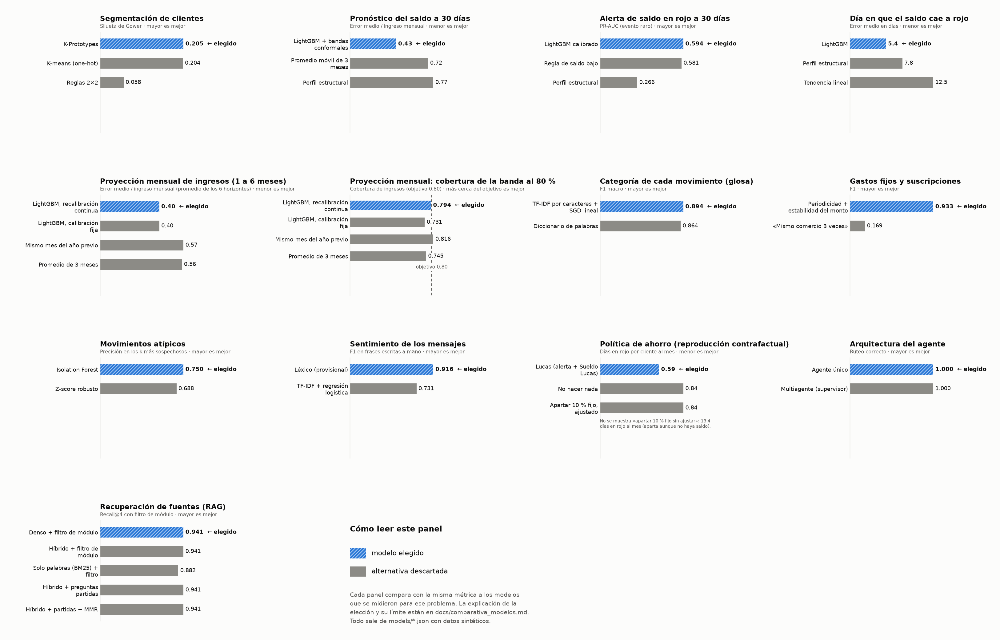

# Comparativa de modelos: qué se midió, qué se eligió y por qué

Generado por `eval/comparativa_modelos.py` solo a partir de `models/*.json`. Datos sintéticos con semilla fija. En negrita, el modelo elegido en cada problema. Cada fila trae también el límite de la comparación: lo que no demuestra.

Una imagen por problema para las diapositivas: `docs/figuras/comparativa/`.

| Problema | Métrica | Resultados (elegido en negrita) | Elegido | Por qué se eligió | Límite |
|---|---|---|---|---|---|
| Segmentación de clientes | Silueta de Gower (mayor es mejor) | **K-Prototypes: 0.205** · K-means (one-hot): 0.204 · Reglas 2×2: 0.058 | **K-Prototypes** | Mezcla variables numéricas y categóricas sin convertirlas a ceros y unos. En silueta de Gower empata con K-means (0.205 frente a 0.204) y supera a las reglas 2×2 (0.058); donde se separa es en recuperar los arquetipos reales de la población simulada (ARI 0.253 frente a 0.218 y 0.022). Se eligen k=3 segmentos: es el de mayor puntaje entre los k con estabilidad de remuestreo ≥ 0.60 (silueta 0.205, estabilidad ARI 0.744, segmento más chico de 68 clientes). | La silueta de K-Prototypes y K-means es casi la misma: la ventaja está en los arquetipos recuperados, no en la silueta. |
| Pronóstico del saldo a 30 días | Error medio / ingreso mensual (menor es mejor) | **LightGBM + bandas conformales: 0.43** · Promedio móvil de 3 meses: 0.72 · Perfil estructural: 0.77 | **LightGBM + bandas conformales** | Error de 0.43 veces el ingreso mensual frente a 0.72 del promedio móvil y 0.77 del perfil estructural (41% menos error que el promedio móvil). La banda al 80 % cubre 0.806 de los casos (objetivo 0.80) con una banda más angosta (1.30 frente a 1.68); el promedio móvil cubre solo 0.722. Hiperparámetros con Optuna (25 pruebas) y calibración conformal por segmento, validado en 2024 a 2025 sin haberlo visto al entrenar. | Está calibrado en el día 30. Una serie diaria con banda al 80 % para cada uno de los 30 días no está entrenada ni validada. |
| Alerta de saldo en rojo a 30 días | PR-AUC (evento raro) (mayor es mejor) | **LightGBM calibrado: 0.594** · Regla de saldo bajo: 0.581 · Perfil estructural: 0.266 | **LightGBM calibrado** | PR-AUC 0.594 frente a 0.581 de la regla simple y 0.266 del perfil estructural; el azar daría 0.044. La ventaja real es la calibración: error de calibración (ECE) de 0.005 frente a 0.022 de la regla, así que el «p_rojo» que ve la persona se puede leer como una probabilidad. ROC-AUC 0.977. | La ventaja sobre la regla simple en PR-AUC es modesta (0.013); lo que justifica el modelo es la calibración. Evento raro: 4.4% de los casos. |
| Día en que el saldo cae a rojo | Error medio en días (menor es mejor) | **LightGBM: 5.4** · Perfil estructural: 7.8 · Tendencia lineal: 12.5 | **LightGBM** | Se equivoca en promedio 5.4 días frente a 7.8 del perfil estructural y 12.5 de la tendencia lineal; acierta dentro de ±3 días el 43% de las veces (contra 37% y 19%). | Es la parte más débil del pronóstico: menos de la mitad de los días de riesgo cae a ±3 días. Por eso la app dice «hacia el día X», no una fecha exacta. Casos con día de riesgo: 2134. |
| Proyección mensual de ingresos (1 a 6 meses) | Error medio / ingreso mensual (promedio de los 6 horizontes) (menor es mejor) | **LightGBM, recalibración continua: 0.40** · LightGBM, calibración fija: 0.40 · Mismo mes del año previo: 0.57 · Promedio de 3 meses: 0.56 | **LightGBM, recalibración continua** | Error de ingresos de 0.40 veces el ingreso mensual frente a 0.57 (mismo mes del año previo) y 0.56 (promedio de 3 meses); en gastos el error es de solo 0.10. Con la misma predicción puntual, la recalibración continua corrige la banda: cubre 0.794 de los ingresos (objetivo 0.80) y la calibración fija 0.731. | El ingreso de independientes y mixtos es mucho más difícil de proyectar que el de dependientes: el error depende del tipo de trabajo (ver tabla por tipo en docs/EVALUACION_ANALITICA.md). |
| Proyección mensual: cobertura de la banda al 80 % | Cobertura de ingresos (objetivo 0.80) (cerca de 0.80 es mejor) | **LightGBM, recalibración continua: 0.794** · LightGBM, calibración fija: 0.731 · Mismo mes del año previo: 0.816 · Promedio de 3 meses: 0.745 | **LightGBM, recalibración continua** | La banda debería contener el ingreso real el 80 % de las veces. La recalibración continua queda en 0.794; la calibración fija se desajusta con el tiempo (0.731) y el promedio de 3 meses queda corto (0.745). El mismo mes del año previo cubre 0.816 pero con un error mucho mayor (0.57 frente a 0.40). | Cubrir más que el objetivo no es mejor: una banda demasiado ancha deja de ser útil. |
| Categoría de cada movimiento (glosa) | F1 macro (mayor es mejor) | **TF-IDF por caracteres + SGD lineal: 0.894** · Diccionario de palabras: 0.864 | **TF-IDF por caracteres + SGD lineal** | F1 macro de 0.894 frente a 0.864 del diccionario, con la misma exactitud (0.989) sobre 30,000 movimientos: con igual exactitud, un F1 macro mayor indica que acierta mejor en las categorías poco frecuentes. Se descartó LinearSVC por tiempo de entrenamiento (más de 13 minutos en esta laptop sin terminar). | El generador usa plantillas de glosa: con glosas reales de un banco la métrica será menor. En el agente, una glosa desconocida cae a «otros» si la confianza es menor de 0.80. |
| Gastos fijos y suscripciones | F1 (mayor es mejor) | **Periodicidad + estabilidad del monto: 0.933** · «Mismo comercio 3 veces»: 0.169 | **Periodicidad + estabilidad del monto** | Precisión de 0.999 y F1 de 0.933. La regla «mismo comercio tres veces» recupera todo (1.00 de recall) pero con precisión de 0.092: marca como fijo cualquier compra repetida y llenaría de falsas alertas. Evaluado en 150 clientes. | Recall de 0.88: se le escapan algunos recurrentes con montos o fechas irregulares. |
| Movimientos atípicos | Precisión en los k más sospechosos (mayor es mejor) | **Isolation Forest: 0.750** · Z-score robusto: 0.688 | **Isolation Forest** | Isolation Forest acierta 75.0% de los marcados frente a 68.8% del z-score robusto, sobre 800,000 movimientos con 2,066 atípicos sembrados por el generador. Detecta combinaciones raras de variables, no solo montos altos. | Los atípicos son sembrados por el generador: en datos reales la precisión será distinta y hay que revisarla con casos etiquetados por analistas. |
| Sentimiento de los mensajes | F1 en frases escritas a mano (mayor es mejor) | **Léxico (provisional): 0.916** · TF-IDF + regresión logística: 0.731 | **Léxico (provisional)** | Sin ganador definitivo. El modelo entrenado aprende las plantillas del generador (F1 1.00 contra 0.62 del léxico) pero cae a 0.73 con 24 frases escritas a mano, donde el léxico llega a 0.92. Se toma el léxico como referencia hasta tener un set independiente. | Solo 24 frases escritas a mano: el resultado es indicativo. Además el texto no mejora el pronóstico (ver comparación de texto en docs/EVALUACION_ANALITICA.md), así que el sentimiento no está en producción. |
| Política de ahorro (reproducción contrafactual) | Días en rojo por cliente al mes (menor es mejor) | **Lucas (alerta + Sueldo Lucas): 0.59** · No hacer nada: 0.84 · Apartar 10 % fijo, ajustado: 0.84 | **Lucas (alerta + Sueldo Lucas)** | Es la única política que reduce los días en rojo: 0.59 por cliente al mes frente a 0.84 sin hacer nada (29% menos; 0.24 días evitados, IC95 0.19 a 0.30) y deja S/ 322 más de colchón (IC95 290 a 357). Apartar un 10 % fijo sin ajustar deja 13.4 días en rojo al mes; con el ajuste solo iguala a no hacer nada (0.84). | El 10 % fijo ajustado forma más colchón (4.8 meses frente a 2.0 de Lucas): Lucas gana en días en rojo, no en colchón. Es un hallazgo abierto. Reproducción sobre datos sintéticos. |
| Arquitectura del agente | Ruteo correcto (mayor es mejor) | **Agente único: 1.000** · Multiagente (supervisor): 1.000 | **Agente único** | Mismo ruteo correcto (1.000), misma latencia media (0.94 s frente a 0.41 s) y ninguno inventa cifras en 69 preguntas: el multiagente no aporta una mejora medible. Se usa el agente único por ser más simple y fácil de auditar; el multiagente queda como arquitectura demostrable. | Evaluado con plantillas (sin LLM) sobre preguntas escritas por el equipo: mide el ruteo y las salvaguardas, no la calidad de redacción de un LLM. |
| Recuperación de fuentes (RAG) | Recall@4 con filtro de módulo (mayor es mejor) | **Denso + filtro de módulo: 0.941** · Híbrido + filtro de módulo: 0.941 · Solo palabras (BM25) + filtro: 0.882 · Híbrido + preguntas partidas: 0.941 · Híbrido + partidas + MMR: 0.941 | **Denso + filtro de módulo** | Con filtro de módulo, denso e híbrido empatan en recall@4 (0.941); partir las preguntas y MMR no mejoraron nada medible. Se mantiene el denso porque el filtro de relevancia (umbral 0.70) se calibra sobre su similitud: acepta 33 de 34 preguntas con respuesta y rechaza 10 de 11 ajenas (AUC 0.979). | Con 34 preguntas, una sola mueve el recall 0.029: diferencias de una pregunta no son concluyentes. La expansión de siglas se motivó por un fallo de esta misma evaluación, así que ese caso no es prueba independiente. |

<!-- huella_metricas: 547dc044afbc5de0 (la puerta de calidad compara esta huella con la de las metricas actuales) -->
