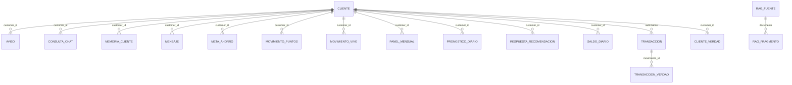

# Modelo de datos de Lucas (PostgreSQL)

Plan del modelo de datos y su esquema **listo para crear** en PostgreSQL 15 o superior con la extension `pgvector`, para quien haga la integracion final. El equipo aun no tiene base de datos: con este esquema, el cargador y la evidencia de validacion se crea y se llena en minutos. Todo esta **probado contra un PostgreSQL real** con la data sintetica completa.

| Archivo | Para que sirve |
|---|---|
| [`schema_postgres.sql`](schema_postgres.sql) | El esquema completo (`lucas` y `simulacion`): tablas, claves, restricciones, indices, vista de limpieza y vectores |
| [`validacion_postgres.json`](validacion_postgres.json) | Evidencia de la prueba contra Postgres real (cargas, cascadas, restricciones, busqueda vectorial) |
| [`../../analitica/eval/cargar_a_postgres.py`](../../analitica/eval/cargar_a_postgres.py) | Cargador: crea el esquema, carga los Parquet con COPY, carga el RAG con sus vectores y verifica los conteos |
| Este documento | Plan, diccionario de cada tabla y diagrama entidad-relacion (generado desde el SQL por `eval/generar_modelo_de_datos.py`) |

## 1. Decisiones de diseno

1. **Dos esquemas.** `lucas` es lo que usa el aplicativo y lo que existiria con datos reales de un banco. `simulacion` guarda la **verdad oculta** del generador sintetico (arquetipo, parametros internos, etiquetas de referencia): sirve para evaluar los modelos y **nunca** debe leerlo un modelo ni el aplicativo (es lo que `src/models/columnas.py` ya separa en observable, etiqueta e interna). Con datos reales se borra el esquema entero: `DROP SCHEMA simulacion CASCADE`.
2. **Los defectos sembrados se conservan a proposito.** Los movimientos traen faltantes (glosa 2 %, categoria 3 %, saldo 1,5 %, monto 0,2 %) y duplicados, para probar la limpieza. Por eso `lucas.transaccion` tiene clave propia (`movimiento_id`, identidad), `transaction_id` no es unico y las columnas son nulas donde corresponde. La vista `lucas.transaccion_limpia` quita los duplicados exactos; los cercanos los quita `src/generador/calidad.py::limpiar`.
3. **Derecho de supresion.** Todo lo que cuelga de un cliente se borra con el (`ON DELETE CASCADE`), igual que `memoria.olvidar`. Se probo: borrar un cliente borra sus movimientos, saldos, panel, mensajes y su verdad oculta, sin filas huerfanas.
4. **Dinero en `NUMERIC(14,2)`**, nunca en flotantes; tasas y porcentajes en `NUMERIC`; parametros del simulador en `DOUBLE PRECISION`. Fechas como `DATE`, `TIMESTAMP` o `CHAR(7)` (`AAAA-MM`) segun el dato.
5. **Vectores en la misma base.** El RAG (3.761 fragmentos tras depurar los repetidos) y las preguntas frecuentes viven con `pgvector`: columnas `vector(768)` (nomic-embed-text, vectores normalizados) con indice HNSW de **producto interno**, que equivale al coseno. Ademas `rag_fragmento.texto_tsv` (texto completo en espanol) reemplaza al BM25 local para una busqueda hibrida dentro de SQL.
6. **Observabilidad sin texto.** `lucas.consulta_chat` guarda por respuesta el proveedor, las llamadas y tokens, las cifras verificadas y el estado del RAG, pero **no** la pregunta ni la respuesta.
7. **Particion.** Con millones de movimientos conviene particionar `lucas.transaccion` por `fecha_hora` (rango anual); el SQL deja la nota (con la particion declarativa la clave primaria debe incluir `fecha_hora`).

## 2. Diagrama entidad-relacion



Las tablas del RAG (`rag_fuente` 1 a N `rag_fragmento`) y las preguntas frecuentes no cuelgan de un cliente: son conocimiento compartido. El diagrama grafico para la presentacion esta en `docs/presentacion/diagramas/modelo_de_datos.png`.

## 1. Clientes y movimientos (data sintetica; con datos reales los trae la entidad)

### `lucas.cliente`

Origen: `clientes.parquet` (columnas observables). Filas en la data sintetica: **500**.

| Columna | Tipo | Restricciones | Nota |
|---|---|---|---|
| `customer_id` | TEXT | PRIMARY KEY |  |
| `rango_edad` | TEXT | NOT NULL | 18-24, 25-34, 35-44, 45-54, 55+ |
| `region` | TEXT | NOT NULL | lima, norte, sur, centro, oriente |
| `departamento` | TEXT | NOT NULL | ubicacion gruesa; nunca coordenadas |
| `tipo_trabajo` | TEXT | NOT NULL | dependiente, dependiente_con_comision, independiente, mixto |
| `frecuencia_ingreso` | TEXT | NOT NULL | quincenal, mensual_mas_comision, diaria, irregular, mensual_mas_extra |
| `personas_a_cargo` | SMALLINT | NOT NULL CHECK (personas_a_cargo BETWEEN 0 AND 10) |  |
| `deuda_total` | NUMERIC(14,2) | NOT NULL DEFAULT 0 CHECK (deuda_total >= 0) |  |
| `n_creditos` | SMALLINT | NOT NULL DEFAULT 0 CHECK (n_creditos >= 0) |  |
| `cuota_mensual` | NUMERIC(14,2) | NOT NULL DEFAULT 0 CHECK (cuota_mensual >= 0) |  |
| `tcea_promedio` | NUMERIC(6,3) | NOT NULL DEFAULT 0 |  |
| `colchon_meses` | NUMERIC(6,2) | NOT NULL DEFAULT 0 |  |
| `antiguedad_cliente_meses` | INTEGER | NOT NULL CHECK (antiguedad_cliente_meses >= 0) |  |
| `meta_ahorro` | NUMERIC(14,2) | NOT NULL DEFAULT 0 |  |
| `paga_en_usd` | BOOLEAN | NOT NULL DEFAULT FALSE |  |
| `creado_el` | TIMESTAMPTZ | NOT NULL DEFAULT now() |  |

### `lucas.transaccion`

Origen: `transacciones/*.parquet` (sin las etiquetas es_*). Filas en la data sintetica: **3,264,148**.

| Columna | Tipo | Restricciones | Nota |
|---|---|---|---|
| `movimiento_id` | BIGINT | GENERATED BY DEFAULT AS IDENTITY PRIMARY KEY | la carga masiva lo da explicito; la app lo deja automatico |
| `customer_id` | TEXT | NOT NULL REFERENCES lucas.cliente (customer_id) ON DELETE CASCADE |  |
| `transaction_id` | TEXT | NOT NULL | NO es unico: hay duplicados exactos sembrados para probar la limpieza |
| `fecha_hora` | TIMESTAMP | NOT NULL |  |
| `monto` | NUMERIC(14,2) |  | en la moneda original; nulo en el 0,2 % sembrado como faltante |
| `moneda` | CHAR(3) | CHECK (moneda IN ('PEN', 'USD')) |  |
| `monto_pen` | NUMERIC(14,2) |  |  |
| `tipo` | TEXT | NOT NULL CHECK (tipo IN ('ingreso', 'gasto')) |  |
| `categoria` | TEXT |  | nula en ~3 % (faltante sembrado) |
| `comercio` | TEXT |  |  |
| `glosa` | TEXT |  | nula en ~2 % |
| `canal` | TEXT |  |  |
| `saldo` | NUMERIC(14,2) |  | nulo en ~1,5 % |

### `lucas.saldo_diario`

Origen: `saldo_diario/*.parquet`. Filas en la data sintetica: **1,278,500**.

| Columna | Tipo | Restricciones | Nota |
|---|---|---|---|
| `customer_id` | TEXT | NOT NULL REFERENCES lucas.cliente (customer_id) ON DELETE CASCADE |  |
| `fecha` | DATE | NOT NULL |  |
| `ingresos` | NUMERIC(14,2) | NOT NULL DEFAULT 0 |  |
| `gastos` | NUMERIC(14,2) | NOT NULL DEFAULT 0 |  |
| `saldo_cierre` | NUMERIC(14,2) | NOT NULL |  |
| `en_rojo` | BOOLEAN | NOT NULL |  |

### `lucas.panel_mensual`

Origen: `panel_mensual/*.parquet`. Filas en la data sintetica: **42,000**.

| Columna | Tipo | Restricciones | Nota |
|---|---|---|---|
| `customer_id` | TEXT | NOT NULL REFERENCES lucas.cliente (customer_id) ON DELETE CASCADE |  |
| `mes` | CHAR(7) | NOT NULL | AAAA-MM |
| `ahorro_movido` | NUMERIC(14,2) | NOT NULL DEFAULT 0 |  |
| `gasto_deuda` | NUMERIC(14,2) | NOT NULL DEFAULT 0 |  |
| `gasto_fijo` | NUMERIC(14,2) | NOT NULL DEFAULT 0 |  |
| `gasto_hormiga` | NUMERIC(14,2) | NOT NULL DEFAULT 0 |  |
| `gasto_variable` | NUMERIC(14,2) | NOT NULL DEFAULT 0 |  |
| `ingreso_extraordinario` | NUMERIC(14,2) | NOT NULL DEFAULT 0 |  |
| `ingreso_financiero` | NUMERIC(14,2) | NOT NULL DEFAULT 0 |  |
| `ingreso_operativo` | NUMERIC(14,2) | NOT NULL DEFAULT 0 |  |
| `n_transacciones` | INTEGER | NOT NULL DEFAULT 0 |  |
| `saldo_fin` | NUMERIC(14,2) | NOT NULL |  |
| `saldo_min` | NUMERIC(14,2) | NOT NULL |  |
| `dias_en_rojo` | SMALLINT | NOT NULL DEFAULT 0 CHECK (dias_en_rojo BETWEEN 0 AND 31) |  |

### `lucas.mensaje`

Origen: `mensajes/*.parquet`. Filas en la data sintetica: **44,924**.

| Columna | Tipo | Restricciones | Nota |
|---|---|---|---|
| `mensaje_id` | BIGSERIAL | PRIMARY KEY |  |
| `customer_id` | TEXT | NOT NULL REFERENCES lucas.cliente (customer_id) ON DELETE CASCADE |  |
| `fecha_hora` | TIMESTAMP | NOT NULL |  |
| `texto` | TEXT | NOT NULL |  |
| `sentimiento` | TEXT | CHECK (sentimiento IN ('positivo', 'neutro', 'preocupado', 'negativo')) | en produccion lo pone un modelo; el sentimiento no esta en produccion hoy |

### `lucas.contexto_diario`

Origen: `contexto_diario.parquet`. Filas en la data sintetica: **2,557**.

| Columna | Tipo | Restricciones | Nota |
|---|---|---|---|
| `fecha` | DATE | PRIMARY KEY |  |
| `dia_semana` | SMALLINT | NOT NULL |  |
| `dia_mes` | SMALLINT | NOT NULL |  |
| `mes` | SMALLINT | NOT NULL |  |
| `fuerza_covid_confinamiento` | REAL | NOT NULL DEFAULT 0 |  |
| `fuerza_covid_reapertura` | REAL | NOT NULL DEFAULT 0 |  |
| `fuerza_covid_segunda_ola` | REAL | NOT NULL DEFAULT 0 |  |
| `fuerza_protestas_2022_2023` | REAL | NOT NULL DEFAULT 0 |  |
| `fuerza_nino_costero_2023` | REAL | NOT NULL DEFAULT 0 |  |

### `lucas.evento`

Origen: `eventos.parquet`. Filas en la data sintetica: **5**.

| Columna | Tipo | Restricciones | Nota |
|---|---|---|---|
| `evento_id` | TEXT | PRIMARY KEY |  |
| `nombre` | TEXT | NOT NULL |  |
| `tipo` | TEXT | NOT NULL |  |
| `inicio` | DATE | NOT NULL |  |
| `fin` | DATE | NOT NULL |  |
| `estado` | TEXT | NOT NULL CHECK (estado IN ('verificado', 'parcial', 'supuesto')) |  |
| `fuente` | TEXT | NOT NULL |  |

### `lucas.macro_mensual`

Origen: `macro_mensual.parquet` (series reales del BCRP). Filas en la data sintetica: **84**.

| Columna | Tipo | Restricciones | Nota |
|---|---|---|---|
| `mes` | CHAR(7) | PRIMARY KEY | AAAA-MM; series reales del BCRP |
| `ipc_var_mensual` | REAL |  |  |
| `ipc_relativo` | REAL |  |  |
| `tasa_referencia_bcrp` | REAL |  |  |
| `tipo_cambio_venta` | REAL |  |  |

## 2. Verdad oculta del simulador (solo para evaluar; con datos reales se borra el esquema `simulacion`)

### `simulacion.cliente_verdad`

Origen: `clientes.parquet` (etiquetas y parametros internos del simulador). Filas en la data sintetica: **500**.

| Columna | Tipo | Restricciones | Nota |
|---|---|---|---|
| `customer_id` | TEXT | PRIMARY KEY REFERENCES lucas.cliente (customer_id) ON DELETE CASCADE |  |
| `arquetipo` | TEXT | NOT NULL |  |
| `subtipo` | TEXT |  |  |
| `segmento` | TEXT | NOT NULL |  |
| `perfil_ahorro_real` | TEXT | NOT NULL |  |
| `perfil_gasto_real` | TEXT | NOT NULL |  |
| `necesidad_oculta` | TEXT | NOT NULL |  |
| `prob_acepta_reco` | DOUBLE PRECISION | NOT NULL |  |
| `cambio_patron` | BOOLEAN | NOT NULL |  |
| `peso_muestral` | DOUBLE PRECISION | NOT NULL |  |
| `ingreso_base` | DOUBLE PRECISION | NOT NULL |  |
| `gasto_ratio` | DOUBLE PRECISION | NOT NULL |  |
| `ahorro_tasa` | DOUBLE PRECISION | NOT NULL |  |
| `fraccion_efectivo` | DOUBLE PRECISION | NOT NULL |  |
| `traspaso_inflacion` | DOUBLE PRECISION | NOT NULL |  |
| `planilla` | BOOLEAN | NOT NULL |  |
| `tiene_alquiler` | BOOLEAN | NOT NULL |  |
| `alquiler_share` | DOUBLE PRECISION | NOT NULL |  |
| `tiene_deuda` | BOOLEAN | NOT NULL |  |
| `cuota_share` | DOUBLE PRECISION | NOT NULL |  |
| `saldo_inicial` | DOUBLE PRECISION | NOT NULL |  |
| `ahorro_inicial` | DOUBLE PRECISION | NOT NULL |  |
| `acceso_credito_informal` | BOOLEAN | NOT NULL |  |
| `tasa_credito_informal` | DOUBLE PRECISION | NOT NULL |  |
| `pos_cambio_patron` | DOUBLE PRECISION |  |  |
| `factor_cambio_ingreso` | DOUBLE PRECISION | NOT NULL |  |
| `heterogeneidad_consumo` | DOUBLE PRECISION | NOT NULL |  |
| `lote` | INTEGER | NOT NULL |  |

### `simulacion.transaccion_verdad`

Origen: `transacciones/*.parquet` (es_recurrente, es_atipico, es_suscripcion_duplicada). Filas en la data sintetica: **3,264,148**.

| Columna | Tipo | Restricciones | Nota |
|---|---|---|---|
| `movimiento_id` | BIGINT | PRIMARY KEY REFERENCES lucas.transaccion (movimiento_id) ON DELETE CASCADE |  |
| `es_recurrente` | BOOLEAN | NOT NULL |  |
| `es_atipico` | BOOLEAN | NOT NULL |  |
| `es_suscripcion_duplicada` | BOOLEAN | NOT NULL |  |

### `simulacion.calidad_etiqueta`

Origen: `etiquetas_calidad/*.parquet`. Filas en la data sintetica: **230,775**.

| Columna | Tipo | Restricciones | Nota |
|---|---|---|---|
| `transaction_id` | TEXT | NOT NULL | no es clave: un mismo id puede tener varios problemas |
| `tipo_problema` | TEXT | NOT NULL | falta_categoria, falta_glosa, falta_saldo, falta_monto, duplicado_exacto, duplicado_cercano |

## 3. Lo que el aplicativo y el agente guardan al funcionar

### `lucas.movimiento_vivo`

Origen: aplicativo (`datos_vivos.registrar`, `POST /expenses`).

| Columna | Tipo | Restricciones | Nota |
|---|---|---|---|
| `customer_id` | TEXT | NOT NULL REFERENCES lucas.cliente (customer_id) ON DELETE CASCADE |  |
| `id` | TEXT | NOT NULL | id del aplicativo: con el mismo id el registro es idempotente |
| `tipo` | TEXT | NOT NULL CHECK (tipo IN ('ingreso', 'gasto')) |  |
| `monto` | NUMERIC(14,2) | NOT NULL CHECK (monto > 0) |  |
| `categoria` | TEXT | NOT NULL |  |
| `origen_categoria` | TEXT | NOT NULL | app, modelo, sin_clasificar, categoria_desconocida |
| `confianza_categoria` | NUMERIC(4,3) | NOT NULL |  |
| `fecha` | TIMESTAMP | NOT NULL |  |
| `registrado_en` | TIMESTAMPTZ | NOT NULL DEFAULT now() |  |

### `lucas.memoria_cliente`

Origen: agente (`memoria.py`).

| Columna | Tipo | Restricciones | Nota |
|---|---|---|---|
| `customer_id` | TEXT | PRIMARY KEY REFERENCES lucas.cliente (customer_id) ON DELETE CASCADE |  |
| `preferencias` | JSONB | NOT NULL DEFAULT '{}' | por ejemplo {"idioma": "qu"} |
| `puntos` | INTEGER | NOT NULL DEFAULT 0 |  |
| `actualizado_el` | TIMESTAMPTZ | NOT NULL DEFAULT now() |  |

### `lucas.meta_ahorro`

Origen: aplicativo (propuesta).

| Columna | Tipo | Restricciones | Nota |
|---|---|---|---|
| `meta_id` | BIGSERIAL | PRIMARY KEY |  |
| `customer_id` | TEXT | NOT NULL REFERENCES lucas.cliente (customer_id) ON DELETE CASCADE |  |
| `nombre` | TEXT | NOT NULL |  |
| `monto_objetivo` | NUMERIC(14,2) | NOT NULL CHECK (monto_objetivo > 0) |  |
| `aporte_por_periodo` | NUMERIC(14,2) |  |  |
| `periodicidad` | TEXT | CHECK (periodicidad IN ('quincenal', 'mensual')) |  |
| `creada_el` | TIMESTAMPTZ | NOT NULL DEFAULT now() | propuesta: hoy las metas se guardan como lista libre en la memoria |

### `lucas.respuesta_recomendacion`

Origen: agente (`memoria.registrar_respuesta`).

| Columna | Tipo | Restricciones | Nota |
|---|---|---|---|
| `customer_id` | TEXT | NOT NULL REFERENCES lucas.cliente (customer_id) ON DELETE CASCADE |  |
| `reco_id` | TEXT | NOT NULL |  |
| `respuesta` | TEXT | NOT NULL CHECK (respuesta IN ('util', 'no_me_sirve')) | las rechazadas bajan en el ranking |
| `actualizada_el` | TIMESTAMPTZ | NOT NULL DEFAULT now() |  |

### `lucas.movimiento_puntos`

Origen: agente (`memoria.sumar_puntos`).

| Columna | Tipo | Restricciones | Nota |
|---|---|---|---|
| `id` | BIGSERIAL | PRIMARY KEY |  |
| `customer_id` | TEXT | NOT NULL REFERENCES lucas.cliente (customer_id) ON DELETE CASCADE |  |
| `fecha` | TIMESTAMPTZ | NOT NULL DEFAULT now() |  |
| `accion` | TEXT | NOT NULL |  |
| `puntos` | INTEGER | NOT NULL |  |

### `lucas.aviso`

Origen: vigilante (`vigilancia.ciclo`).

| Columna | Tipo | Restricciones | Nota |
|---|---|---|---|
| `aviso_id` | BIGSERIAL | PRIMARY KEY |  |
| `customer_id` | TEXT | NOT NULL REFERENCES lucas.cliente (customer_id) ON DELETE CASCADE |  |
| `fecha` | TIMESTAMPTZ | NOT NULL DEFAULT now() |  |
| `tipo` | TEXT | NOT NULL | riesgo_rojo, libre_disposicion_por_vencer, calendario_laboral, ingreso_extra, gasto_atipico, baja_de_tasa, fen_comunicado... |
| `clave` | TEXT |  |  |

### `lucas.consulta_chat`

Origen: agente (campos de `responder()`).

| Columna | Tipo | Restricciones | Nota |
|---|---|---|---|
| `consulta_id` | BIGSERIAL | PRIMARY KEY |  |
| `customer_id` | TEXT | REFERENCES lucas.cliente (customer_id) ON DELETE SET NULL |  |
| `creada_el` | TIMESTAMPTZ | NOT NULL DEFAULT now() |  |
| `intencion` | TEXT | NOT NULL |  |
| `proveedor` | TEXT | NOT NULL | gemini, compatible, ollama, faq, cache, plantilla |
| `idioma` | TEXT | NOT NULL DEFAULT 'es' |  |
| `llamadas_llm` | SMALLINT | NOT NULL DEFAULT 0 |  |
| `tokens_entrada` | INTEGER |  |  |
| `tokens_salida` | INTEGER |  |  |
| `cifras_verificadas` | SMALLINT | NOT NULL DEFAULT 0 |  |
| `cifras_sin_respaldo` | SMALLINT | NOT NULL DEFAULT 0 |  |
| `rag_estado` | TEXT |  |  |
| `segundos` | NUMERIC(6,2) |  |  |

### `lucas.pronostico_diario`

Origen: modelo (`contrato.pronostico_contrato`), cache opcional.

| Columna | Tipo | Restricciones | Nota |
|---|---|---|---|
| `customer_id` | TEXT | NOT NULL REFERENCES lucas.cliente (customer_id) ON DELETE CASCADE |  |
| `fecha_base` | DATE | NOT NULL | cierre de datos desde el cual se pronostica |
| `dia` | SMALLINT | NOT NULL CHECK (dia BETWEEN 1 AND 30) |  |
| `saldo_esperado` | NUMERIC(14,2) | NOT NULL |  |
| `saldo_bajo` | NUMERIC(14,2) | NOT NULL | banda al 80 % |
| `saldo_alto` | NUMERIC(14,2) | NOT NULL |  |
| `modelo` | TEXT | NOT NULL | lightgbm-cuantil-conformal-serie-diaria-v1 |
| `generado_el` | TIMESTAMPTZ | NOT NULL DEFAULT now() |  |

## 4. RAG y preguntas frecuentes

### `lucas.rag_fuente`

Origen: `docs/rag/fuentes.csv`.

| Columna | Tipo | Restricciones | Nota |
|---|---|---|---|
| `documento` | TEXT | PRIMARY KEY | modulo/archivo |
| `modulo` | TEXT | NOT NULL |  |
| `titulo` | TEXT | NOT NULL |  |
| `institucion` | TEXT |  |  |
| `contexto` | TEXT |  | Peru u otro pais (el agente avisa si la fuente no es peruana) |
| `licencia_nivel` | CHAR(1) | NOT NULL CHECK (licencia_nivel IN ('A', 'B', 'C')) | solo el nivel A entra al indice |
| `enlace` | TEXT |  |  |
| `sha256` | TEXT |  |  |
| `fecha_consulta` | DATE |  |  |

### `lucas.rag_fragmento`

Origen: `docs/rag/indice/` (fragmentos y vectores FAISS).

| Columna | Tipo | Restricciones | Nota |
|---|---|---|---|
| `id` | INTEGER | PRIMARY KEY |  |
| `documento` | TEXT | NOT NULL REFERENCES lucas.rag_fuente (documento) ON DELETE CASCADE |  |
| `modulo` | TEXT | NOT NULL |  |
| `pagina` | INTEGER | NOT NULL CHECK (pagina >= 1) |  |
| `texto` | TEXT | NOT NULL | 900 caracteres con 120 de solape |
| `embedding` | vector(768) | NOT NULL | nomic-embed-text con el prefijo «search_document: », normalizado |
| `texto_tsv` | TSVECTOR | GENERATED ALWAYS AS (to_tsvector('spanish', texto)) STORED |  |

### `lucas.faq_aprendida`

Origen: agente (`faq.py`).

| Columna | Tipo | Restricciones | Nota |
|---|---|---|---|
| `id` | BIGSERIAL | PRIMARY KEY |  |
| `palabras` | TEXT | NOT NULL | palabras significativas de la pregunta, solo las del corpus del RAG; sin digitos ni nombres propios |
| `nivel` | TEXT | NOT NULL | el tono cambia por nivel de la persona |
| `respuesta` | TEXT | NOT NULL | verificada y sin datos de la persona |
| `fragmentos` | JSONB | NOT NULL | las fuentes citadas |
| `huella_indice` | TEXT | NOT NULL | indice del RAG con el que se armo: si cambia, deja de usarse |
| `veces` | INTEGER | NOT NULL DEFAULT 1 |  |
| `aprendida_el` | DATE | NOT NULL |  |

### `lucas.faq_preguntas_vistas`

Origen: agente (`faq.py`).

| Columna | Tipo | Restricciones | Nota |
|---|---|---|---|
| `palabras` | TEXT | NOT NULL |  |
| `intencion` | TEXT | NOT NULL |  |
| `veces` | INTEGER | NOT NULL DEFAULT 1 |  |

### `lucas.faq_contadores`

Origen: agente (`faq.py`).

| Columna | Tipo | Restricciones | Nota |
|---|---|---|---|
| `nombre` | TEXT | PRIMARY KEY | consultas_de_concepto, respondidas_sin_llm, sin_evidencia_en_las_fuentes |
| `valor` | INTEGER | NOT NULL DEFAULT 0 |  |

### `lucas.faq_embedding`

Origen: `faq.exportar_para_embeddings()` + nomic-embed-text.

| Columna | Tipo | Restricciones | Nota |
|---|---|---|---|
| `id` | TEXT | PRIMARY KEY | el id de faq.exportar_para_embeddings(): semilla-N o aprendida-N |
| `pregunta` | TEXT | NOT NULL |  |
| `embedding` | vector(768) | NOT NULL |  |

## 6. Como crearla y cargarla

```bash
# 1. Una base con pgvector (ejemplo con Docker; en el servidor del equipo basta CREATE EXTENSION vector)
docker run -d --name lucas-pg -e POSTGRES_PASSWORD=<clave> -e POSTGRES_DB=lucas -p 5432:5432 pgvector/pgvector:pg16

# 2. Crear el esquema y cargar la data sintetica y el RAG con sus vectores (~3 minutos)
export DATABASE_URL=postgresql://postgres:<clave>@localhost:5432/lucas
python eval/cargar_a_postgres.py --crear --rag

# Solo ver que se cargaria, sin base de datos
python eval/cargar_a_postgres.py --plan
```

El cargador usa `COPY` y al final **verifica que cada tabla tenga las mismas filas que su Parquet**. La clave del usuario va solo en `DATABASE_URL`, nunca en el repositorio. Con datos reales no se carga el esquema `simulacion` y las tablas de la seccion 1 las llena el sistema de la entidad con la misma estructura.

## 7. Evidencia de validacion (PostgreSQL real)

Probado el 2026-11-14 con PostgreSQL 16.16 (Debian 16.16-1.pgdg12+1) y pgvector 0.8.7; la base con todo cargado pesa 1283 MB y tiene 25 tablas. Fuente: [`validacion_postgres.json`](validacion_postgres.json).

| Comprobacion | Resultado |
|---|---|
| Carga completa: filas de cada tabla frente a su Parquet | las 11 tablas cargadas coinciden (3.264.148 movimientos, 1.278.500 saldos diarios, 44.924 mensajes...) |
| La vista `transaccion_limpia` quita los duplicados exactos | 3,264,148 filas, 3,256,382 ids distintos, vista con 3,256,382: OK |
| Borrar un cliente borra todo lo suyo (cascada) | OK: del cliente `C00001` desaparecen 24,539 filas y no queda ninguna huerfana |
| `movimiento_id` es identidad (la app inserta sin darlo) | OK |
| Las restricciones rechazan lo invalido (tipo, cliente inexistente, banda cruzada) | CheckViolation, ForeignKeyViolation, CheckViolation |
| Busqueda vectorial en SQL = busqueda del indice local | mismos 3 fragmentos (3342, 2097, 3321), similitud 0.7602 |
| Busqueda por palabras en SQL (`texto_tsv`) | OK (3 resultados) |
| El indice HNSW se puede usar | OK: con 3.761 filas el planificador prefiere un barrido exacto; con el barrido apagado el plan usa el indice HNSW |

**Lo que la validacion corrigio:** el comentario del esquema decia que la similitud era `1 + (embedding <#> consulta)`; `<#>` devuelve el producto interno **negativo**, asi que la similitud coseno es `-(embedding <#> consulta)` (0,76 y no 0,24 en la prueba). Ya esta corregido en el SQL.

## 8. Lo que queda para el equipo

- **Datos reales:** la entidad llena las tablas de la seccion 1; los modelos solo leen `lucas`. Las columnas nulas de los movimientos son normales (glosa, categoria, saldo).
- **Embeddings de las preguntas frecuentes:** `faq.exportar_para_embeddings()` deja el JSONL; vectorizarlo con nomic-embed-text y cargarlo en `lucas.faq_embedding`. Para trasladar la FAQ aprendida de SQLite a Postgres, las tablas son las mismas (ver la seccion 9.4 del informe).
- **Particion** de `lucas.transaccion` si el volumen real lo pide, y los permisos por rol (el aplicativo solo escribe en las tablas de la seccion 3).
